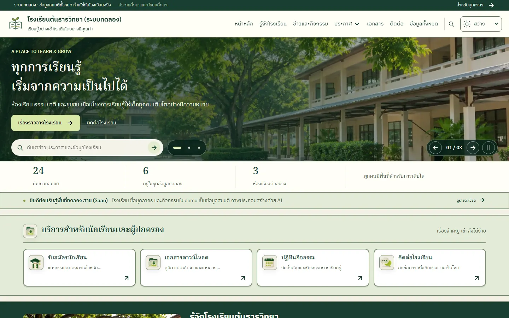
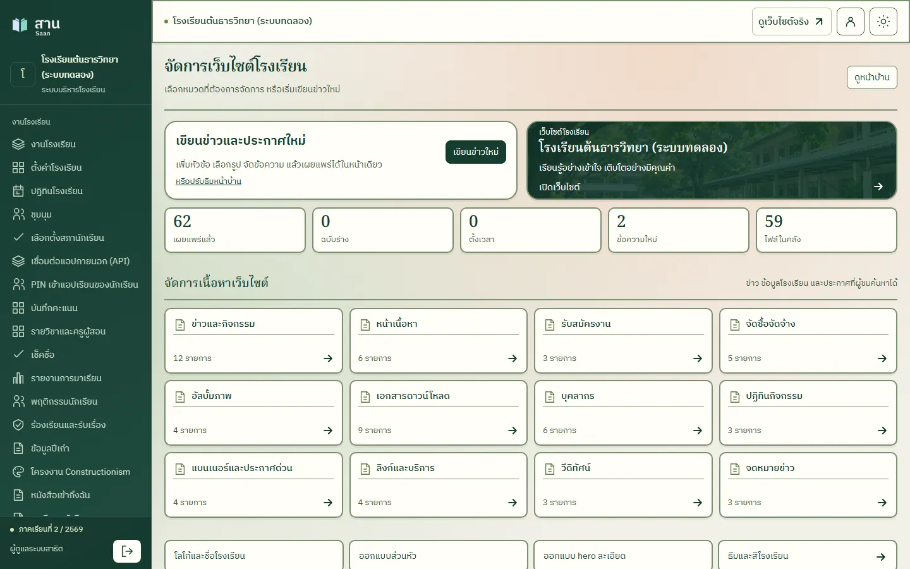

# สาน (Saan)

ระบบบริหารจัดการสถานศึกษาแบบซอฟต์แวร์เสรี สำหรับโรงเรียนไทย: เว็บไซต์โรงเรียนและงานภายในอยู่ในระบบเดียว ติดตั้งบนโฮสติ้งของโรงเรียนเอง โรงเรียนเป็นเจ้าของข้อมูล

รุ่น **0.9.0** (เลขรุ่นจริงอยู่ในไฟล์ `VERSION`) · Laravel 13 · PHP 8.4.1 ขึ้นไป · MariaDB / MySQL · licence [AGPL-3.0-only](LICENSE) · สถานะ: รุ่นทดสอบ (beta)

| | |
|---|---|
| เว็บไซต์โครงการ | https://saan.linuxthai.org |
| ดาวน์โหลดแพ็กเกจและค่า SHA-256 | https://saan.linuxthai.org/download/ |
| คู่มือติดตั้งและวิกิ | https://saan.linuxthai.org/docs/ |
| ข่าวและประกาศของโครงการ | https://saan.linuxthai.org/news/ |
| ขอความช่วยเหลือ | https://saan.linuxthai.org/request/ |
| แจ้งช่องโหว่ (ส่วนตัว) | https://saan.linuxthai.org/security/ และ [SECURITY.md](SECURITY.md) |
| ซอร์สโค้ด (repository นี้) | https://github.com/ChonLaWan/saan |
| ชุมชน LinuxThai | https://linuxthai.org |

เว็บไซต์โครงการอยู่ภายใต้ LinuxThai (linuxthai.org) รุ่นที่เผยแพร่ ค่าตรวจสอบไฟล์ คู่มือ และประกาศความปลอดภัยอยู่ที่นั่น ส่วน repository นี้เก็บซอร์สโค้ดและรับการแก้ไข





## ท่านทำอะไรได้จากที่นี่

| ท่านคือ | ทำอะไรได้ | เริ่มที่ |
|---|---|---|
| ผู้บริหารหรือครูที่อยากรู้ว่าระบบทำอะไรได้ | ดูความสามารถตามกลุ่มงานและระดับความพร้อมของแต่ละโมดูล | https://saan.linuxthai.org/features/ |
| ผู้ที่อยากลองก่อนตัดสินใจ | ติดตั้งแบบ "ทดลองเต็มระบบ (โรงเรียนสมมติ)" บนเครื่องทดสอบ ได้โรงเรียนสมมติพร้อมบัญชีทุกบทบาท | หัวข้อ [ติดตั้งผ่านเว็บ](#ติดตั้งผ่านเว็บ) ด้านล่าง |
| ผู้ดูแลระบบของโรงเรียนหรือโฮสติ้ง | ติดตั้งบนโฮสติ้งหรือด้วย Docker อัปเดต สำรองและกู้คืน ตรวจความพร้อมของระบบ | [คู่มือติดตั้ง](docs/installation.th.html) และ [RUNBOOK.txt](RUNBOOK.txt) |
| นักพัฒนา | อ่านโค้ด รันชุดทดสอบ ส่งการแก้ไขเป็น Pull Request | [CONTRIBUTING.md](CONTRIBUTING.md) และหัวข้อ [พัฒนาและทดสอบ](#พัฒนาและทดสอบ) |
| ผู้พบข้อผิดพลาด | แจ้งผ่าน Issue ของ repository นี้ (ใช้ข้อมูลสมมติเท่านั้น) | แท็บ Issues |
| ผู้พบช่องโหว่ | แจ้งแบบส่วนตัว ห้ามเปิด Issue สาธารณะ | [SECURITY.md](SECURITY.md) |

## ระบบมีอะไรบ้าง

- **เว็บไซต์โรงเรียน** (โมดูล `web-cms`): เนื้อหา 12 ประเภท พร้อมหลังบ้าน ธีม 3 แบบ โลโก้ favicon hero slideshow คลังสื่อ
  ข่าว หน้าเนื้อหา รับสมัครงาน จัดซื้อจัดจ้าง อัลบั้ม ดาวน์โหลด บุคลากร ปฏิทิน แบนเนอร์ บริการ วิดีโอ และจดหมายข่าว มี draft/publish/preview และ version checks
- **งานโรงเรียน** แยกเป็นโมดูล (ตอนนี้ 31 โมดูลใน `modules/` เช่น ทะเบียนนักเรียน เช็คชื่อ ตารางสอน คะแนนและรายงานผลการเรียน การเงิน สลิปเงินเดือน สารบรรณ ร้องเรียน) ระดับ beta ทั้งหมด ยกเว้น `operations` ที่เป็น experimental
- **พอร์ทัลนักเรียนและผู้ปกครอง** ดูผลการเรียน ตารางเรียน การมาเรียน และความประพฤติ
- **ติดตั้งและดูแลได้โดยไม่ต้องมี SSH**: ตัวติดตั้งบนเว็บ ตัวอัปเดตแพ็กเกจที่ลงลายเซ็นพร้อมคืนรุ่นเดิมเองเมื่อไม่สำเร็จ สำรองข้อมูลอัตโนมัติ และหน้าตรวจความพร้อมของระบบ

ดูสถานะและเปิด/ปิดโมดูลที่ `/admin/modules` หลังติดตั้ง

## สิ่งที่ต้องมี

- PHP **8.4.1 ขึ้นไป (8.4 หรือ 8.5)** พร้อมส่วนขยาย ctype, curl, dom, fileinfo, filter, gd, hash, intl, mbstring, openssl, pdo, pdo_mysql, session, sodium, tokenizer, xml, xmlreader, zip
- **MariaDB 10.6 ขึ้นไป หรือ MySQL 8.0 ขึ้นไป** เท่านั้น (ไม่รองรับ SQLite หรือฐานข้อมูลอื่น)
- HTTPS สำหรับเว็บจริง (HTTP ใช้ได้เฉพาะ localhost/127.0.0.1)
- ไม่ต้องมี SSH ในการติดตั้งและอัปเดตตามปกติ (File Manager และหลังบ้านเพียงพอ) แต่การกู้ข้อมูลจากไฟล์สำรองต้องใช้บรรทัดคำสั่ง (ดูด้านล่าง)

## ติดตั้งด้วย Docker (Windows และ Linux)

เครื่องที่ติดตั้ง Docker ได้ (Docker Desktop บน Windows หรือ Docker Engine บน Linux) ติดตั้งสานทั้งระบบได้ด้วยคำสั่งเดียว container ติดตั้งแบบมาตรฐาน โมดูลครบ HTTPS และงานตามเวลาให้เอง รหัสผ่านทุกตัวสร้างใหม่ในเครื่องนั้น ผู้ดูแลระบบตั้งรหัสผ่านของตัวเองเมื่อเข้าระบบครั้งแรก (image ใช้ Debian 13, Apache 2.4, PHP 8.4 และ MariaDB 11.8)

```bash
git clone https://github.com/ChonLaWan/saan.git
cd saan/docker
cp .env.example .env        # Windows PowerShell: Copy-Item .env.example .env
docker compose up -d --build
docker compose exec saan saan-credentials
```

คู่มือพร้อมรูปทุกขั้นตอน: [docs/container.th.md](docs/container.th.md) หรือ https://saan.linuxthai.org/wiki/install/docker/

## ติดตั้งผ่านเว็บ

1. ดาวน์โหลดแพ็กเกจ `saan-core-<รุ่น>.zip` จาก https://saan.linuxthai.org/download/ (มี vendor รวมแล้ว ไม่ต้องใช้ Composer) ตรวจ SHA-256 แตกเฉพาะโฟลเดอร์ `payload/` ไว้นอกโฟลเดอร์ที่เปิดจากเว็บ
   โมดูลเสริม `saan-mod-<id>-<รุ่น>.zip` แตก `payload/` ทับลงโฟลเดอร์เดียวกันก่อนติดตั้ง หรือติดตั้งภายหลังด้วยตัวอัปเดต
   (นักพัฒนาใช้ source ZIP หรือ git แล้วรัน `composer install --no-dev --prefer-dist` ได้)
2. ตั้ง DocumentRoot ของโดเมนไปที่ `public/` ของแอป เปิด HTTPS และให้ account ของเว็บเขียน storage, bootstrap/cache และโฟลเดอร์แอปได้ชั่วคราว
3. **ไม่ต้อง copy .env สำหรับ wizard** เปิด `/install/` อ่านรหัสเจ้าของผ่าน File Manager จาก `storage/app/private/setup/owner-token.txt`
4. ขั้นตอน wizard 5 ขั้น: ตรวจเครื่องและกรอกรหัสเจ้าของ → เลือกรูปแบบการติดตั้ง → ฐานข้อมูล → โรงเรียน/ผู้ดูแล/โหมดข้อมูล → เสร็จ
   รูปแบบ **มาตรฐาน (แนะนำ)** ใช้สองโฟลเดอร์แอป (ระบบภายใน และหน้าบ้านสาธารณะ) สองโดเมนหรือซับโดเมน สองฐานข้อมูล สองผู้ใช้ฐานข้อมูล
   ส่วน "สาธิต/ทดลอง" เป็นระบบเดียวรวมทุกอย่าง ไม่เหมาะกับใช้งานจริง และ "ขั้นสูง" แยกสองเครื่อง (docs/split-advanced.th.md)
5. เข้าด้วยผู้ดูแลที่สร้างเอง ตัวติดตั้งล็อกตัวเองเมื่อเสร็จ ไม่มีรหัสผ่านเริ่มต้นร่วมกัน ปิด demo-login เสมอ
6. ตั้ง cron `schedule:run` ทุกนาที **ทุกโฟลเดอร์แอป** (แบบมาตรฐานคือ 2 บรรทัด) ไม่ต้องรัน queue worker

### รูปแบบข้อมูลเริ่มต้น

- **ข้อมูลตัวอย่าง:** ชุด CMS เดิม 62 รายการ/12 ประเภท/53 ไฟล์สื่อ พร้อมข้อมูลปฏิบัติงานสมมติบางส่วน ไม่มีบัญชี/รหัสผ่าน/session/ร่างส่วนตัวจากเครื่องต้นทาง
- **เว็บเปล่า:** ไม่มีข่าว/บุคลากร/นักเรียนสมมติที่เผยแพร่ คงเมนู ธีม หมวด ส่วนหน้าแรก และ 11 ร่างหน้าเนื้อหา/สไลด์/บริการ
- **ทดลองเต็มระบบ (โรงเรียนสมมติ):** โรงเรียนสมมติพร้อมข้อมูลของทุกโมดูลและบัญชีทดลองหนึ่งบัญชีต่อบทบาท (รหัสผ่านสุ่ม แสดงครั้งเดียว) ใช้ทดลองเท่านั้น ห้ามใช้กับโรงเรียนจริง

คู่มือภาษาไทยละเอียด: [docs/installation.th.html](docs/installation.th.html) หรือเปิด `/manual/` หลังติดตั้ง สรุปคำสั่งปฏิบัติการอยู่ใน [RUNBOOK.txt](RUNBOOK.txt)
ตัวอย่าง Apache/nginx/PHP/cron/database อยู่ `config/examples/` ใช้กับโดเมนหลัก; subfolder ดูคู่มือ

## สำรอง กู้คืน และอัปเกรด

- สำรองอัตโนมัติ (ระบบภายในและระบบรวม): เมื่อมี cron ระบบสร้าง `storage/app/private/backups/auto-YYYYMMDD.zip` ทุกวัน 02:30 เก็บ 7 ไฟล์ล่าสุด
  ตั้งด้วย `SAAN_BACKUP_DAILY_AT` (เว้นว่าง = ปิด) และ `SAAN_BACKUP_KEEP` ต้องดาวน์โหลดไฟล์ออกจากเซิร์ฟเวอร์เป็นระยะ ไฟล์มีข้อมูลโรงเรียนและ APP_KEY
- สำรองเอง: `php artisan school:archive backup /private/backups/site.zip` เก็บนอก public และไม่เขียนทับ ZIP เดิม
- กู้คืน (ต้องใช้บรรทัดคำสั่ง) ลงฐานข้อมูลใหม่ที่ว่างเท่านั้น: `php artisan school:archive restore /private/backups/site.zip --yes-empty-database`
  คืน database/private media/APP_KEY โดยรักษาฐานข้อมูลและ URL เป้าหมายที่ตั้งไว้ ตัวอย่างและข้อจำกัดอยู่คู่มือ
- อัปเดต: วางแพ็กเกจที่ลงลายเซ็น (`saan-core-*.zip`, `saan-mod-*.zip`) ที่ `storage/app/private/updates/incoming/` แล้วกดติดตั้งที่ `/cms#deployment` หรือ `php artisan saan:update <zip>`
  ทั้งรุ่นในคำสั่งเดียว: `php artisan saan:update --all=<โฟลเดอร์ของรุ่น>` การติดตั้งแบบมาตรฐานสองโฟลเดอร์ใช้ `php artisan saan:update --both <zip>` ระบบสำรองฐานข้อมูล ปิดเว็บชั่วคราว และคืนรุ่นเดิมเองถ้าไม่สำเร็จ (ดู RUNBOOK.txt)
- ตรวจ `php artisan school:doctor` (หรือหน้า `/cms#deployment`) หลัง deploy/upgrade
- ห้าม `migrate:fresh` / DatabaseSeeder ทับฐานเดิม ตัวติดตั้งไม่ใช่ระบบอัปเกรด

## สถานะการพัฒนา

รุ่น beta โรงเรียนต้องตรวจรับบน staging ก่อนใช้งานจริงและสำรองข้อมูลเสมอ
มี: โมดูลงานโรงเรียนระดับ beta (รวมทะเบียนนักเรียนและที่เก็บเอกสารยืนยันตัวตนแบบส่วนตัวในโมดูล `registry`), ลืมรหัสผ่านทางอีเมล, ยืนยันสองขั้นตอน (MFA) สำหรับผู้ใช้, ตัวอัปเดตแพ็กเกจที่ลงลายเซ็น `saan:update` พร้อมคืนรุ่นเดิมอัตโนมัติ, หลังบ้านตั้งค่า Gmail App Password / SMTP พร้อมทดสอบส่ง
ยังไม่มีหลักฐานการตรวจรับกับข้อมูลจริงของโรงเรียน อย่าเก็บข้อมูลบัตร ทะเบียนบ้าน หรือสุขภาพนักเรียนจริงจนกว่าโรงเรียนจะตรวจรับและมีนโยบาย PDPA ของตนเอง; ดู SECURITY.md
ภาพบุคลากรและข้อมูล demo เป็นข้อมูลสมมติทั้งหมด
สิ่งที่เปลี่ยนในแต่ละรุ่นอยู่ใน [CHANGELOG.md](CHANGELOG.md)

## พัฒนาและทดสอบ

`composer install` → ตั้ง .env สำหรับฐานทดสอบแยก → `php artisan key:generate` → `composer test`
PHPUnit รันบน MariaDB/MySQL เท่านั้น (ฐานข้อมูลที่ระบบรองรับ) ใช้ฐานทดสอบแยกชื่อ `saan_test` ไม่ใช้ฐานติดตั้งจริง และปฏิเสธฐานที่ชื่อไม่มีคำว่า test หรือ ci ค่าเชื่อมต่ออยู่ใน `phpunit.xml` (แก้ด้วยตัวแปรสภาพแวดล้อม `DB_HOST` `DB_PORT` `DB_DATABASE` `DB_USERNAME` `DB_PASSWORD`) ผู้ใช้ฐานทดสอบต้องสร้างและลบฐานข้อมูลได้ CI อยู่ `.github/workflows/ci.yml` (PHP 8.4/8.5 x MariaDB 10.6, MariaDB 11.8, MySQL 8.0, php -l, node --check, สแกนความลับ, สร้างและตรวจแพ็กเกจรุ่นด้วยกุญแจทดสอบ)
ชุดทดสอบฝั่งเซิร์ฟเวอร์ไม่ได้เปิดหน้าจอ การตรวจหน้าจอในเบราว์เซอร์จริง (ข้อความล้น ทับกัน หน้าเลื่อนแนวนอน) ใช้ `tests/browser/layout_audit.py` ดู [tests/browser/README.md](tests/browser/README.md)
ก่อนเผยแพร่ซอร์สรัน `php tools/release/scan-secrets.php` (ตรวจกุญแจ รหัสผ่าน เลขบัตร 13 หลัก เบอร์โทร อีเมลจริง ไฟล์ใหญ่ ตาม .gitignore) และแก้ทุกรายการระดับ high ก่อน ขั้นตอนออกรุ่นอยู่ `tools/release/README.md`
ดู CONTRIBUTING.md, SECURITY.md, LICENSE และ THIRD-PARTY-NOTICES.txt ก่อนแจกจ่ายต่อ
รายงานภายใน/ฐานข้อมูล/อัปโหลด/.env ไม่อยู่ใน Git ชุด demo ที่แจกคือ resources/install/demo ที่ตรวจ checksum; คลังภาพและเอกสารสมมติฉบับเต็มเป็น optional resources/install/library ในชุด upload-ready

## สัญญาอนุญาต

สาน (Saan) เผยแพร่ภายใต้ GNU Affero General Public License version 3 (AGPL-3.0-only) ดูไฟล์ [LICENSE](LICENSE)
ใช้ แก้ไข และแจกจ่ายต่อได้ฟรี ผู้ที่นำโค้ดไปแก้แล้วให้บริการผ่านเครือข่าย (เช่น เปิดเว็บให้โรงเรียนอื่นใช้) ต้องเปิดซอร์สโค้ดของรุ่นที่แก้ให้ผู้ใช้เครือข่ายนั้นดาวน์โหลดได้
ไลบรารีภายนอกใน vendor/ และฟอนต์คงสัญญาอนุญาตของแต่ละรายการ

## English summary

Saan is a free (AGPL-3.0-only) school platform for Thai schools: the public school website (CMS) and internal school work (student registry, timetable, attendance, grades, finance, documents, portals for students and guardians) in one self-hosted Laravel 13 application (PHP 8.4.1+, MariaDB 10.6+ or MySQL 8.0+). It installs through a web wizard on ordinary shared hosting or with Docker on Windows and Linux (docker/, docs/container.th.md), updates from signed packages with automatic rollback, and is currently beta software. The user interface and the documentation are in Thai.

- Project site, downloads with SHA-256 checksums, manual, wiki and news: https://saan.linuxthai.org (hosted by the LinuxThai community, https://linuxthai.org)
- Report a bug: Issues of this repository, with fictional data only. Report a vulnerability privately: see [SECURITY.md](SECURITY.md).
- Contributions: see [CONTRIBUTING.md](CONTRIBUTING.md).
