# ติดตั้งสาน (Saan) ด้วย Docker บน Windows และ Linux

คู่มือนี้ใช้กับสานรุ่น 0.9.0 ขึ้นไป ติดตั้งสานทั้งระบบบนเครื่องเดียวด้วย Docker ได้ทั้ง Windows 10/11 และ Linux ตั้งแต่ติดตั้ง Docker จนถึงใช้งานประจำวัน สำรองข้อมูล อัปเดต และถอนออก คำสั่งในคู่มือทดสอบจริงบนเครื่อง Windows และ Linux ของโครงการ และรูปทุกรูปมาจากเครื่องทดสอบนั้น ส่วนที่ยังไม่ได้ทดสอบจริงระบุไว้ท้ายคู่มือ

## 1. ได้อะไรเมื่อเปิดครั้งแรก

container ติดตั้งสานให้เองตั้งแต่เปิดครั้งแรก โดยไม่ต้องเปิดตัวติดตั้งในเบราว์เซอร์

| ส่วน | รายละเอียด |
|---|---|
| ระบบภายใน | บุคลากร นักเรียน ผู้ปกครอง หลังบ้านเว็บไซต์ `https://<ที่อยู่>:8443` |
| เว็บไซต์โรงเรียน | หน้าเว็บสาธารณะ `https://<ที่อยู่>:9443` ไม่มีข้อมูลนักเรียนอยู่ฝั่งนี้ |
| ฐานข้อมูล | MariaDB 11.8 แยก container ฐานข้อมูลสองชุดกับผู้ใช้ฐานข้อมูลสองคน (ฝั่งละชุด) |
| โมดูล | ติดตั้งครบทุกโมดูลที่มากับ image (28 โมดูล) |
| ตัวตั้งเวลา | cron ใน container เรียก `schedule:run` ทุกนาทีทั้งสองฝั่ง |
| HTTPS | ใบรับรองที่ออกโดย CA ของเครื่องนั้นเอง หรือใส่ใบรับรองจริงแทนได้ |
| รหัสผ่าน | สร้างใหม่ทุกตัวตอนติดตั้ง (root ฐานข้อมูล ผู้ใช้ฐานข้อมูล ผู้ดูแลระบบ บัญชีทดลอง) ไม่มีรหัสผ่านตั้งต้นที่เหมือนกันทุกเครื่อง |

บัญชีผู้ดูแลระบบที่ container สร้างรหัสผ่านให้ต้องเปลี่ยนรหัสผ่านเมื่อเข้าระบบครั้งแรก ระบบจะเปิดให้เฉพาะหน้า "บัญชีของฉัน" จนกว่าจะตั้งรหัสผ่านใหม่ บัญชีทดลองของโรงเรียนสมมติ (`SAAN_DATA=full`) ไม่ถูกบังคับ เพื่อให้ทุกคนที่ลองใช้บัญชีชุดเดียวกันได้

ภายใน image ใช้ Debian 13 (trixie) กับ Apache 2.4 และ PHP 8.4 จากแพ็กเกจของ Debian

## 2. สิ่งที่ต้องมี

| | ขั้นต่ำ | แนะนำ |
|---|---|---|
| CPU | 64-bit 2 คอร์ เปิด virtualization ใน BIOS (เฉพาะ Windows) | 4 คอร์ |
| RAM | 4 GB ว่าง | 8 GB ขึ้นไป |
| พื้นที่ดิสก์ | 10 GB | 30 GB ขึ้นไป (รวมไฟล์สำรอง) |
| ระบบปฏิบัติการ | Windows 10 22H2 หรือ Windows 11 (64-bit) / Linux ที่มี Docker Engine 24 ขึ้นไป | Debian 13, Ubuntu 24.04 ขึ้นไป |
| พอร์ต | 8443 และ 9443 ว่าง | |

เครื่องที่ใช้เป็นเซิร์ฟเวอร์ของโรงเรียนควรตั้ง IP คงที่ (หรือจองไว้ใน router) เพราะที่อยู่นี้จะอยู่ในลิงก์และใบรับรองของระบบ

## 3. ติดตั้ง Docker

### 3.1 Windows (Docker Desktop)

container ของสานเป็น Linux บน Windows จึงต้องมี Docker Desktop ซึ่งรัน Linux ขนาดเล็กให้ผ่าน WSL2 ทำครั้งเดียวต่อเครื่อง

**ขั้นที่ 1** ดาวน์โหลด Docker Desktop for Windows จาก https://www.docker.com/products/docker-desktop/

**ขั้นที่ 2** เปิดตัวติดตั้งด้วยสิทธิ์ผู้ดูแลเครื่อง เลือก "Use WSL 2 instead of Hyper-V" แล้วกดติดตั้ง

**ขั้นที่ 3** เมื่อตัวติดตั้งขอให้ restart ให้ restart เครื่อง

**ขั้นที่ 4** เปิด Docker Desktop จากเมนู Start ครั้งแรกจะถามเรื่องบัญชี กด Skip ที่มุมขวาบนของกรอบได้ ไม่ต้องสมัคร แล้วรอจนมุมล่างซ้ายขึ้นว่า Engine running

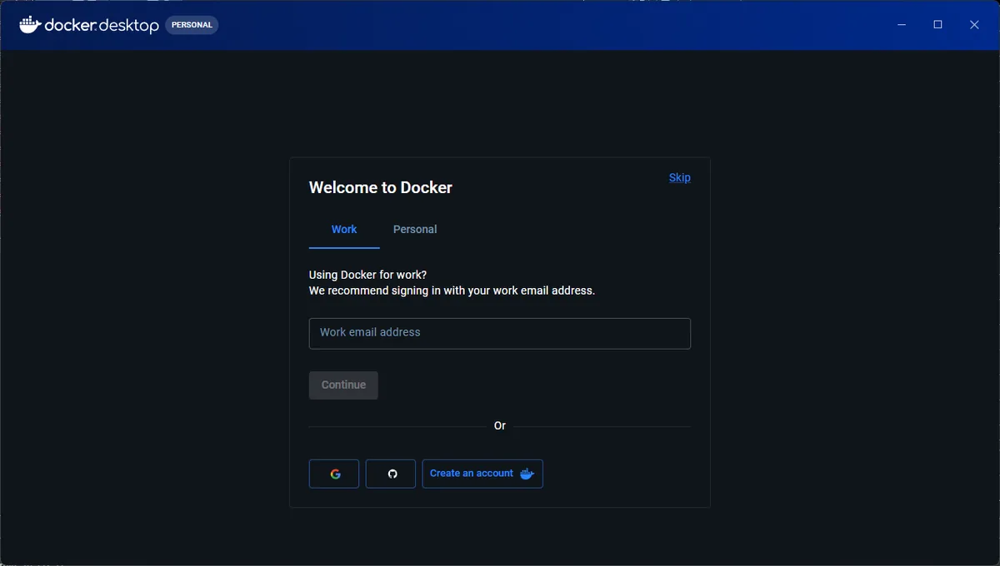

**ขั้นที่ 5** ตั้งให้ Docker เริ่มเองเมื่อเปิดเครื่อง: Settings > General > เลือก "Start Docker Desktop when you sign in to your computer"

**ขั้นที่ 6** เปิด PowerShell แล้วตรวจ

```powershell
docker version
docker compose version
```

ทั้งสองคำสั่งต้องแสดงเลขรุ่นโดยไม่มีข้อผิดพลาด

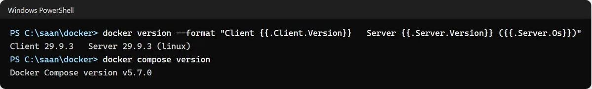

> Docker Desktop ใช้ได้โดยไม่เสียค่าใช้จ่ายสำหรับการศึกษา การใช้ส่วนตัว และองค์กรขนาดเล็ก ตามเงื่อนไขของ Docker Inc. ตรวจเงื่อนไขล่าสุดที่เว็บของ Docker ก่อนใช้ในหน่วยงาน

ถ้าเปิด Docker Desktop แล้วขึ้นว่า virtualization ไม่ได้เปิด ให้เปิด Intel VT-x หรือ AMD-V (SVM) ใน BIOS ของเครื่อง

ถ้าคำสั่ง `wsl --install` หรือตัวติดตั้งแจ้งว่าไม่มี WSL (พบใน Windows รุ่น LTSC/IoT) ให้เปิด PowerShell แบบ Run as administrator แล้วสั่ง

```powershell
dism.exe /online /enable-feature /featurename:Microsoft-Windows-Subsystem-Linux /all /norestart
dism.exe /online /enable-feature /featurename:VirtualMachinePlatform /all /norestart
```

แล้วติดตั้ง WSL จากไฟล์ `wsl.<รุ่น>.x64.msi` ที่ https://github.com/microsoft/WSL/releases restart เครื่อง จากนั้นติดตั้ง Docker Desktop

**เปิด firewall ให้เครื่องอื่นในโรงเรียนเข้าได้** ครั้งแรกที่ระบบเริ่ม Windows อาจถามว่าจะให้ "Docker Desktop Backend" รับการเชื่อมต่อหรือไม่ ให้กด Allow

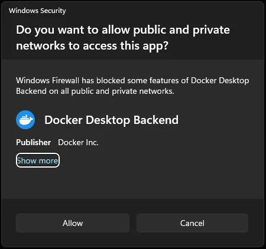

ถ้าไม่ได้ถาม หรือเครือข่ายของเครื่องเป็นแบบ Public (ดูได้ที่ Settings > Network & internet) เครื่องอื่นจะเปิดระบบไม่ได้ ให้เปิด PowerShell แบบ Run as administrator แล้วสั่ง

```powershell
Get-NetFirewallRule -DisplayName 'Docker Desktop Backend' | Where-Object { $_.Action -eq 'Block' } | Disable-NetFirewallRule
New-NetFirewallRule -DisplayName 'Saan (Docker) HTTPS 8443, 9443' -Direction Inbound -Protocol TCP -LocalPort 8443,9443 -RemoteAddress LocalSubnet -Action Allow -Profile Any
```

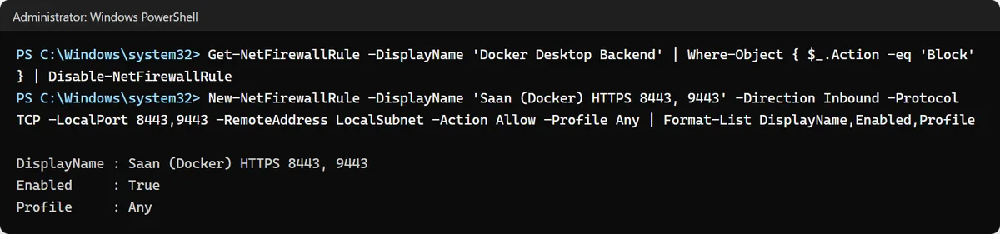

กฎนี้เปิดเฉพาะพอร์ตของสาน และเฉพาะเครื่องในวงเครือข่ายเดียวกัน (LocalSubnet) ถ้าใช้พอร์ตอื่นให้แก้ตัวเลขให้ตรงกับ `.env`

Docker Desktop ทำงานเมื่อมีผู้ใช้ sign in ที่เครื่องเท่านั้น เครื่องที่จะเป็นเซิร์ฟเวอร์ถาวรของโรงเรียนแนะนำ Linux (ข้อ 3.2)

### 3.2 Linux (Docker Engine)

Ubuntu 24.04 ขึ้นไป ใช้แพ็กเกจของ Ubuntu

```bash
sudo apt update
sudo apt install -y docker.io docker-compose-v2 git
sudo usermod -aG docker $USER
```

Debian 13 ใช้ repository ของ Docker

```bash
sudo apt update
sudo apt install -y ca-certificates curl git
sudo install -m 0755 -d /etc/apt/keyrings
sudo curl -fsSL https://download.docker.com/linux/debian/gpg -o /etc/apt/keyrings/docker.asc
echo "deb [arch=$(dpkg --print-architecture) signed-by=/etc/apt/keyrings/docker.asc] https://download.docker.com/linux/debian $(. /etc/os-release && echo $VERSION_CODENAME) stable" | sudo tee /etc/apt/sources.list.d/docker.list
sudo apt update
sudo apt install -y docker-ce docker-ce-cli containerd.io docker-buildx-plugin docker-compose-plugin
sudo usermod -aG docker $USER
```

ออกจากระบบแล้วเข้าใหม่ (หรือ `newgrp docker`) เพื่อให้สิทธิ์กลุ่ม docker มีผล แล้วตรวจ

```bash
docker --version
docker compose version
sudo systemctl enable --now docker
```

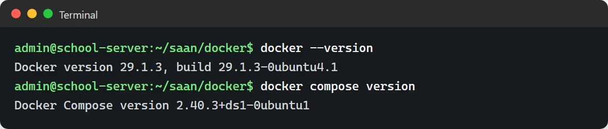

ถ้าเครื่องเปิด firewall (ufw) ให้เปิดสองพอร์ตนี้ให้เครือข่ายของโรงเรียน

```bash
sudo ufw allow 8443/tcp
sudo ufw allow 9443/tcp
```

## 4. เตรียมไฟล์

ไฟล์ของ container อยู่ในโฟลเดอร์ `docker/` ของ repository สาน

```bash
git clone https://github.com/ChonLaWan/saan
cd saan/docker
```

ถ้าไม่มี git ให้ดาวน์โหลด ZIP ของ repository จากหน้า GitHub แตกไฟล์ แล้วเปิดโฟลเดอร์ `docker` ใน PowerShell หรือ terminal

บน Windows แนะนำให้วางไว้ในโฟลเดอร์สั้นๆ เช่น `C:\saan` (สั่ง `cd C:\` ก่อน `git clone`) แล้ว `cd C:\saan\docker`

## 5. ตั้งค่า

คัดลอกไฟล์ตัวอย่างเป็น `.env`

```powershell
# Windows PowerShell
Copy-Item .env.example .env
notepad .env
```

```bash
# Linux
cp .env.example .env
nano .env
```

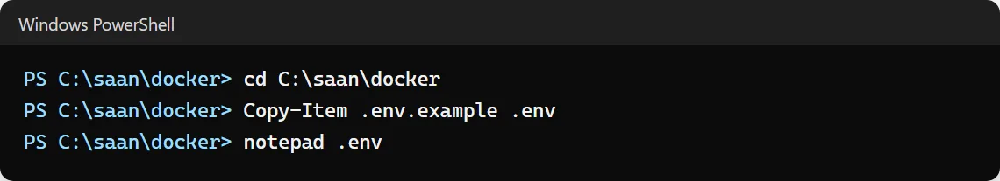

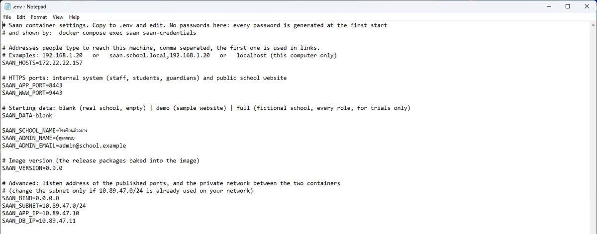

ค่าที่ต้องดู

| ค่า | ความหมาย | ตัวอย่าง |
|---|---|---|
| `SAAN_HOSTS` | ที่อยู่ที่ผู้ใช้พิมพ์เพื่อเข้าเครื่องนี้ คั่นด้วย `,` ตัวแรกใช้ในลิงก์ของระบบ ใบรับรองครอบทุกชื่อในรายการ | `192.168.1.20` หรือ `saan.school.local,192.168.1.20` หรือ `localhost` (ลองบนเครื่องตัวเองเท่านั้น) |
| `SAAN_APP_PORT` | พอร์ต HTTPS ของระบบภายใน | `8443` |
| `SAAN_WWW_PORT` | พอร์ต HTTPS ของเว็บไซต์โรงเรียน | `9443` |
| `SAAN_DATA` | ข้อมูลตั้งต้น: `blank` ระบบว่างสำหรับโรงเรียนจริง / `demo` มีเว็บไซต์ตัวอย่าง / `full` โรงเรียนสมมติครบทุกบทบาท สำหรับทดลองเท่านั้น | `blank` |
| `SAAN_SCHOOL_NAME` | ชื่อโรงเรียน (แก้ภายหลังได้ในหลังบ้าน) | `โรงเรียนบ้านตัวอย่าง` |
| `SAAN_ADMIN_NAME` | ชื่อผู้ดูแลระบบ | `ครูสมศรี ใจดี` |
| `SAAN_ADMIN_EMAIL` | อีเมลที่ใช้เข้าระบบของผู้ดูแลระบบ | `it@school.example` |

ตั้ง `SAAN_HOSTS` ให้ถูกก่อนเริ่มครั้งแรก ลิงก์ในระบบและการจับคู่ระหว่างสองฝั่งใช้ชื่อแรกของรายการนี้ ภายหลังเพิ่มชื่ออื่นต่อท้ายได้ แต่เปลี่ยนชื่อแรกไม่ได้โดยไม่ติดตั้งใหม่

ไฟล์ `.env` ไม่มีรหัสผ่าน ทุกรหัสสร้างขึ้นในเครื่องตอนเปิดครั้งแรก

## 6. เริ่มระบบครั้งแรก

```bash
docker compose up -d --build
```

คำสั่งนี้สร้าง image (ดาวน์โหลด Debian แพ็กเกจของ PHP และแพ็กเกจสานที่ลงลายเซ็นจากเว็บของโครงการ ตรวจ SHA-256 ทุกไฟล์) แล้วเปิด container สามตัว

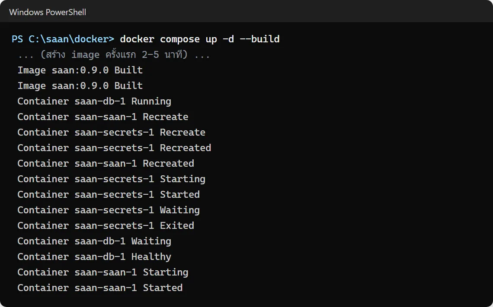

| container | หน้าที่ |
|---|---|
| `saan-secrets-1` | สร้างรหัสผ่าน root ของฐานข้อมูลครั้งเดียวแล้วหยุด (สถานะ Exited (0) เป็นปกติ) |
| `saan-db-1` | MariaDB |
| `saan-saan-1` | สานทั้งสองฝั่ง Apache PHP และ cron |

ดูความคืบหน้าของการติดตั้ง

```bash
docker compose logs -f saan
```

การสร้าง image ครั้งแรกใช้เวลา 2-5 นาทีตามความเร็วอินเทอร์เน็ต การติดตั้งครั้งแรกใช้เวลาประมาณ 5-20 นาทีตามความเร็วของเครื่อง (ติดตั้งแกนระบบ ติดตั้งโมดูลทีละตัวทั้งสองฝั่ง และถ้าเลือก `full` จะสร้างโรงเรียนสมมติต่อ) เสร็จเมื่อเห็นบรรทัด

```
[saan] ... [OK] Saan is installed. Passwords: docker compose exec saan saan-credentials
[saan] ... ready: internal system https://.../login   public website https://.../
```

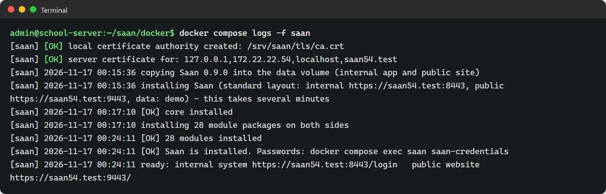

กด Ctrl+C เพื่อออกจากการดู log (container ยังทำงานต่อ)

บน Windows เปิด Docker Desktop ที่หน้า Containers จะเห็นกลุ่ม `saan` มี container สามตัว `secrets-1` ที่หยุดอยู่เป็นปกติ

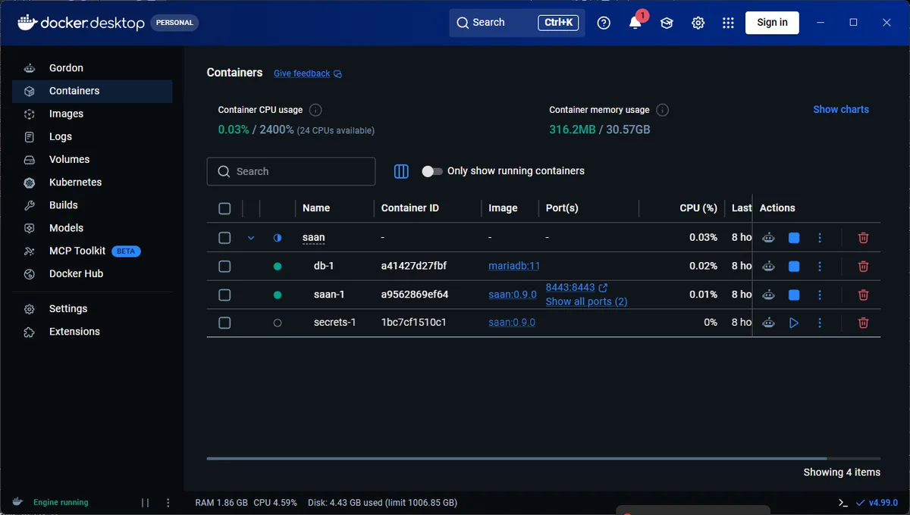

ถ้าการติดตั้งขั้นใดล้มเหลว container จะเริ่มใหม่และทำขั้นนั้นซ้ำเอง ขั้นที่ทำเสร็จแล้วไม่ทำซ้ำ ดูสาเหตุได้ใน log

## 7. รหัสผ่านและการเข้าระบบครั้งแรก

```bash
docker compose exec saan saan-credentials
```

แสดงที่อยู่ของระบบ อีเมลและรหัสผ่านของผู้ดูแลระบบ รหัสผ่านฐานข้อมูล และบัญชีทดลอง (ถ้าเลือก `full`) ไฟล์นี้อยู่ใน volume `saan_secrets` เท่านั้น ไม่อยู่ใน image และไม่อยู่ใน git จดเก็บในที่ปลอดภัย

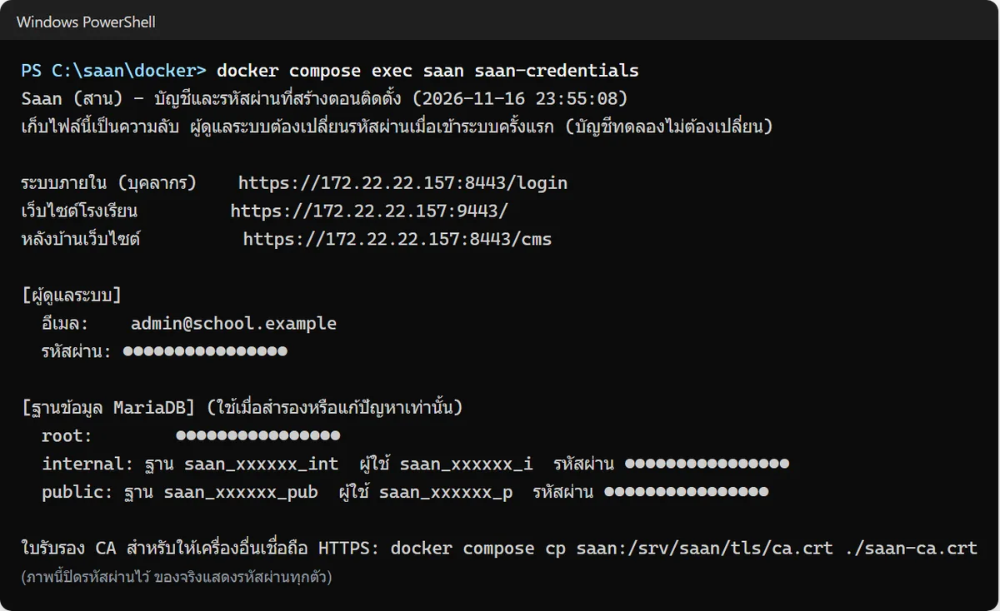

เข้าระบบครั้งแรก

**ขั้นที่ 1** เปิด `https://<ที่อยู่>:8443/login`

**ขั้นที่ 2** เบราว์เซอร์จะเตือนเรื่องใบรับรอง เพราะใบรับรองออกโดย CA ของเครื่องนี้เอง ทำตามข้อ 8 ให้เครื่องที่ใช้ประจำเชื่อถือ หรือกด "ขั้นสูง" แล้ว "ไปต่อ" เพื่อทดลอง

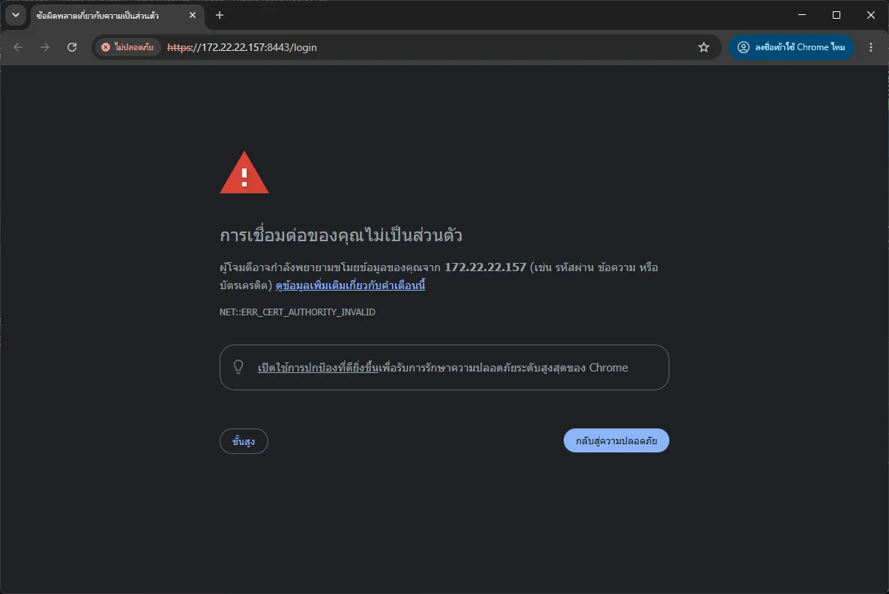

**ขั้นที่ 3** เข้าระบบด้วยอีเมลและรหัสผ่านจาก `saan-credentials`

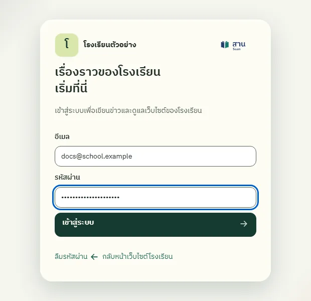

**ขั้นที่ 4** ระบบพาไปหน้า "บัญชีของฉัน" และไม่ให้เข้าเมนูอื่น ให้กรอกรหัสผ่านที่ได้รับในช่องรหัสผ่านปัจจุบัน แล้วตั้งรหัสผ่านใหม่ อย่างน้อย 12 ตัว มีทั้งตัวอักษรอังกฤษและตัวเลข และต้องไม่ซ้ำรหัสเดิม กด "บันทึกรหัสผ่านใหม่"

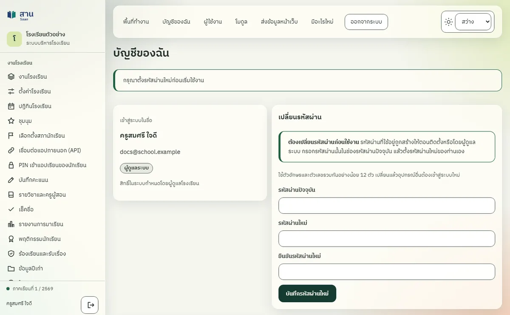

**ขั้นที่ 5** หลังเปลี่ยนแล้วจึงใช้เมนูอื่นได้ แนะนำให้เปิดการยืนยันสองขั้นตอน (MFA) ในหน้าเดียวกัน

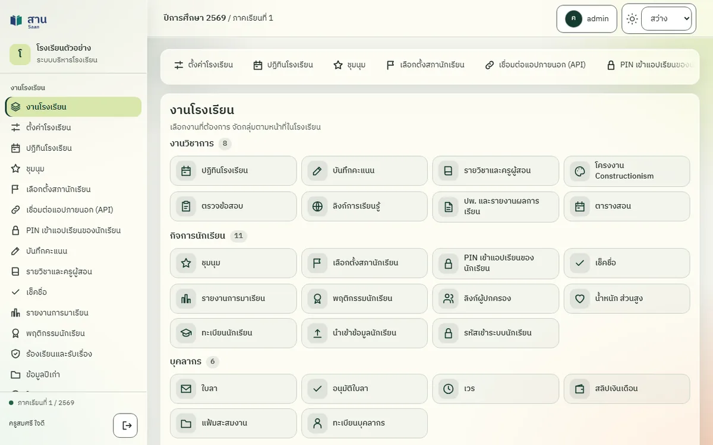

เว็บไซต์โรงเรียนอยู่ที่ `https://<ที่อยู่>:9443/` เนื้อหาแก้ที่หลังบ้าน `https://<ที่อยู่>:8443/cms` แล้วระบบส่งไปหน้าเว็บให้เองภายในหนึ่งนาที

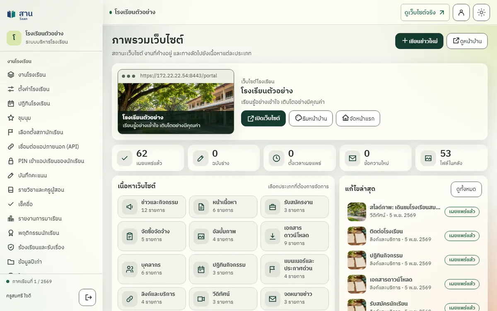

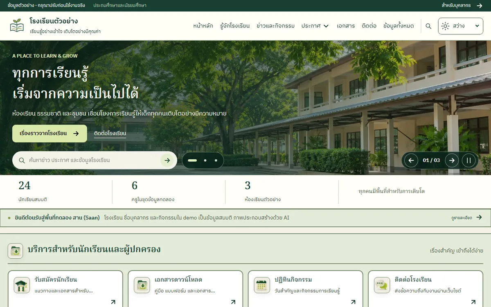

## 8. ให้เครื่องอื่นเชื่อถือใบรับรอง (HTTPS)

คัดลอกใบรับรอง CA ออกมาจาก container

```bash
docker compose cp saan:/srv/saan/tls/ca.crt ./saan-ca.crt
```

ติดตั้งในเครื่องที่ใช้เปิดระบบ (ทำครั้งเดียวต่อเครื่อง)

| เครื่อง | วิธี |
|---|---|
| Windows | เปิด PowerShell แบบ Run as administrator แล้วสั่ง `certutil -addstore -f Root saan-ca.crt` |
| Linux (Debian/Ubuntu) | `sudo cp saan-ca.crt /usr/local/share/ca-certificates/saan-ca.crt && sudo update-ca-certificates` |
| Firefox | Settings > Privacy & Security > Certificates > View Certificates > Authorities > Import แล้วเลือก "Trust this CA to identify websites" |
| Android | ตั้งค่า > ความปลอดภัย > การเข้ารหัสและข้อมูลเข้าสู่ระบบ > ติดตั้งใบรับรอง > ใบรับรอง CA |
| iPhone/iPad | ส่งไฟล์ไปที่เครื่อง เปิดเพื่อติดตั้งโปรไฟล์ แล้วเปิด ตั้งค่า > ทั่วไป > เกี่ยวกับ > การตั้งค่าความเชื่อถือใบรับรอง |

หลังติดตั้ง CA แล้ว เปิดเบราว์เซอร์ใหม่ หน้าเข้าสู่ระบบจะเปิดได้โดยไม่มีคำเตือน

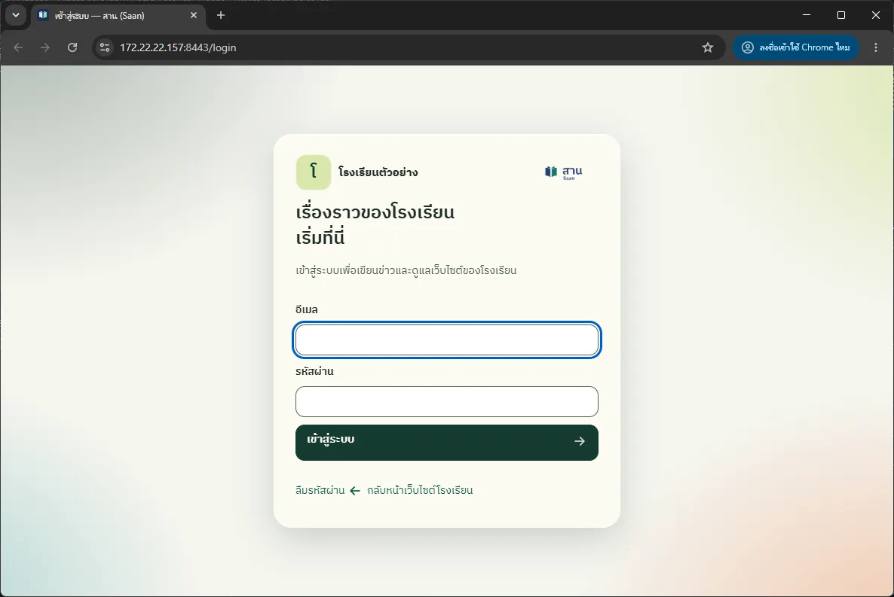

ใบรับรอง CA นี้ใช้ได้เฉพาะกับเครื่องสานเครื่องนี้ เก็บไฟล์ `ca.key` ไว้ใน container ห้ามนำออกไปแจก

ถ้าโรงเรียนมีโดเมนและใบรับรองจริง (เช่น จาก Let's Encrypt) ให้วางไฟล์ไว้ในโฟลเดอร์ `docker/certs/` แล้วแก้ `compose.yaml` ใต้ `saan:` เพิ่มสองบรรทัดในหัวข้อ `environment:` เดิม และเพิ่มหนึ่งบรรทัดในหัวข้อ `volumes:` เดิม

```yaml
    environment:
      SAAN_TLS_CERT: /certs/fullchain.pem
      SAAN_TLS_KEY: /certs/privkey.pem
    volumes:
      - ./certs:/certs:ro
```

แล้ว `docker compose up -d` อีกครั้ง

## 9. คำสั่งใช้งานประจำวัน

สั่งในโฟลเดอร์ `docker` ทุกคำสั่ง (Windows ใช้ PowerShell ได้เหมือนกันทุกคำสั่ง)

| ทำอะไร | คำสั่ง |
|---|---|
| ดูสถานะ container | `docker compose ps` |
| ดูสถานะของสาน (รุ่น โมดูล ใบรับรอง cron ผลตรวจระบบ) | `docker compose exec saan saan-status` |
| ดูรหัสผ่านที่สร้างตอนติดตั้ง | `docker compose exec saan saan-credentials` |
| ดู log สด | `docker compose logs -f saan` |
| หยุดระบบ (ข้อมูลอยู่ครบ) | `docker compose stop` |
| เปิดระบบ | `docker compose start` |
| เริ่มใหม่ | `docker compose restart saan` |
| เปิดหลังแก้ `.env` หรือ `compose.yaml` | `docker compose up -d` |
| ตรวจความพร้อมของระบบ | `docker compose exec saan saan-artisan school:doctor` |
| ส่งข้อมูลไปเว็บไซต์ทั้งหมดใหม่ | `docker compose exec saan saan-artisan saan:publish --full` |
| สำรองข้อมูลทันที | `docker compose exec saan saan-backup` |
| กู้คืนจากไฟล์สำรอง | `docker compose exec saan saan-restore /srv/saan/backups/<ไฟล์>.zip` |
| ติดตั้งแพ็กเกจสานที่ใหม่กว่าจาก image | `docker compose exec saan saan-update` |
| คำสั่ง artisan ฝั่งระบบภายใน | `docker compose exec saan saan-artisan <คำสั่ง>` |
| คำสั่ง artisan ฝั่งเว็บไซต์ | `docker compose exec saan saan-artisan www <คำสั่ง>` |
| บังคับให้ผู้ใช้เปลี่ยนรหัสผ่านครั้งถัดไป | `docker compose exec saan saan-artisan school:require-password-change <อีเมล>` |
| ตั้งรหัสผ่านใหม่ให้บัญชีที่ลืมรหัส (พิมพ์รหัสแบบซ่อน) | `docker compose exec saan saan-artisan school:recover-account <อีเมล>` |
| เปิด shell ใน container | `docker compose exec saan bash` |

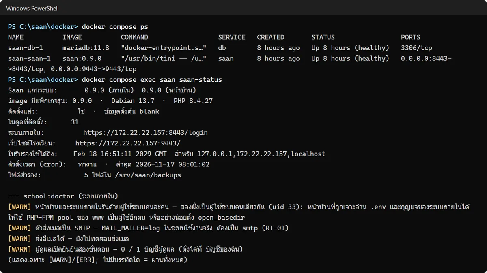

container ทั้งหมดตั้ง `restart: unless-stopped` เมื่อเครื่องเปิดใหม่ ระบบจะกลับมาเอง (บน Windows หลังจาก Docker Desktop เริ่มทำงาน)

## 10. สำรองและกู้คืนข้อมูล

### 10.1 สำรอง

สานสำรองอัตโนมัติตามที่ตั้งในหลังบ้านอยู่แล้ว สั่งสำรองเองเมื่อใดก็ได้

```bash
docker compose exec saan saan-backup
```

ไฟล์อยู่ใน `/srv/saan/backups/` ของ container ต้องคัดลอกออกมาเก็บนอกเครื่องเสมอ

```bash
docker compose exec saan ls -l /srv/saan/backups
docker compose cp saan:/srv/saan/backups/<ชื่อไฟล์>.zip .
```

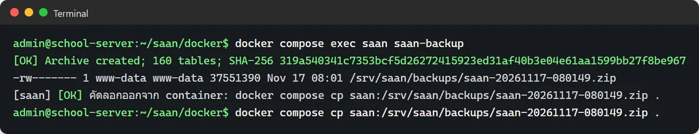

ไฟล์สำรองมีข้อมูลส่วนบุคคลของนักเรียนและบุคลากร เก็บในที่ที่จำกัดคนเข้าถึง

เว็บไซต์โรงเรียนไม่ต้องสำรองแยก เพราะสร้างใหม่จากระบบภายในได้ด้วย `saan:publish --full`

### 10.2 กู้คืนลงระบบเดิม

ใช้กับไฟล์สำรองของระบบนี้เอง (จาก `saan-backup` หรือการสำรองอัตโนมัติ) ข้อมูลปัจจุบันในระบบภายในจะถูกแทนที่ด้วยข้อมูลในไฟล์สำรอง

```bash
docker compose cp ./saan-20261116-120000.zip saan:/srv/saan/backups/
docker compose exec saan saan-restore /srv/saan/backups/saan-20261116-120000.zip
```

`saan-restore` ทำ 6 ขั้นให้เอง

1. สำรองข้อมูลปัจจุบันเก็บไว้ก่อน (ชื่อไฟล์แสดงบนจอ)
2. ปิดระบบชั่วคราว (หน้าแจ้งปรับปรุงระบบ) และพักตัวตั้งเวลา
3. ย้ายไฟล์ส่วนตัวที่มีอยู่ในไฟล์สำรองออกไปพักไว้
4. ล้างฐานข้อมูลของระบบภายใน (สานกู้คืนลงฐานว่างเท่านั้น)
5. กู้คืน
6. เปิดระบบ และส่งข้อมูลทั้งหมดไปเว็บไซต์โรงเรียนใหม่

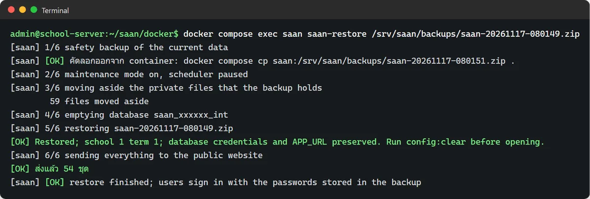

ถ้าขั้นใดล้มเหลว คำสั่งจะคืนไฟล์ที่ย้ายออกไป และบอกชื่อไฟล์สำรองจากขั้นที่ 1 ให้สั่ง `saan-restore <ไฟล์นั้น>` เพื่อกลับไปที่ข้อมูลก่อนกู้คืน

### 10.3 ย้ายไปเครื่องใหม่

ย้ายทั้งระบบด้วยการคัดลอก volume ทั้งสามชุด ได้ทุกอย่างเหมือนเดิม รวมทั้งรหัสผ่าน ใบรับรอง และการจับคู่ระหว่างสองฝั่ง เครื่องใหม่ต้องใช้ที่อยู่เดิม (ย้าย IP หรือชื่อในเครือข่ายตามไปด้วย)

เครื่องเก่า (PowerShell หรือ terminal ในโฟลเดอร์ `docker`)

```bash
docker compose stop
docker run --rm -v saan_data:/v -v ./saan-move:/b saan:0.9.0 tar -C /v -czf /b/saan_data.tgz .
docker run --rm -v saan_db:/v -v ./saan-move:/b saan:0.9.0 tar -C /v -czf /b/saan_db.tgz .
docker run --rm -v saan_secrets:/v -v ./saan-move:/b saan:0.9.0 tar -C /v -czf /b/saan_secrets.tgz .
```

บน Linux ไฟล์ที่ได้เป็นของ root และคนอื่นในเครื่องอ่านได้ ให้สั่ง `sudo chmod 600 saan-move/*` ทันที

คัดลอกโฟลเดอร์ `saan-move` (มีรหัสผ่านทั้งหมด เก็บเป็นความลับ) และไฟล์ `.env` ไปเครื่องใหม่ เครื่องใหม่ติดตั้ง Docker และเตรียมไฟล์ตามข้อ 3 และ 4 วาง `.env` เดิม แล้ว

```bash
docker compose build
docker compose up --no-start
docker run --rm -v saan_data:/v -v ./saan-move:/b saan:0.9.0 tar -C /v -xzf /b/saan_data.tgz
docker run --rm -v saan_db:/v -v ./saan-move:/b saan:0.9.0 tar -C /v -xzf /b/saan_db.tgz
docker run --rm -v saan_secrets:/v -v ./saan-move:/b saan:0.9.0 tar -C /v -xzf /b/saan_secrets.tgz
docker compose up -d
```

ระบบเริ่มทำงานด้วยข้อมูลเดิมโดยไม่ติดตั้งใหม่ ตรวจด้วย `docker compose exec saan saan-status` แล้วลบโฟลเดอร์ `saan-move` เมื่อย้ายเสร็จ

## 11. อัปเดต

### 11.1 อัปเดตสาน (แกนระบบและโมดูล)

วิธีปกติคือหน้า "อัปเดตระบบ" ในหลังบ้าน `https://<ที่อยู่>:8443/admin/updates` (เฉพาะผู้ดูแลระบบ) ระบบสำรองข้อมูลก่อนติดตั้งและคืนรุ่นเดิมเองถ้าไม่สำเร็จ ใช้กับ container ได้เหมือนติดตั้งบนโฮสติ้ง ขั้นตอนเต็มอยู่ในคู่มือ [อัปเดตสาน](https://saan.linuxthai.org/wiki/install/update/)

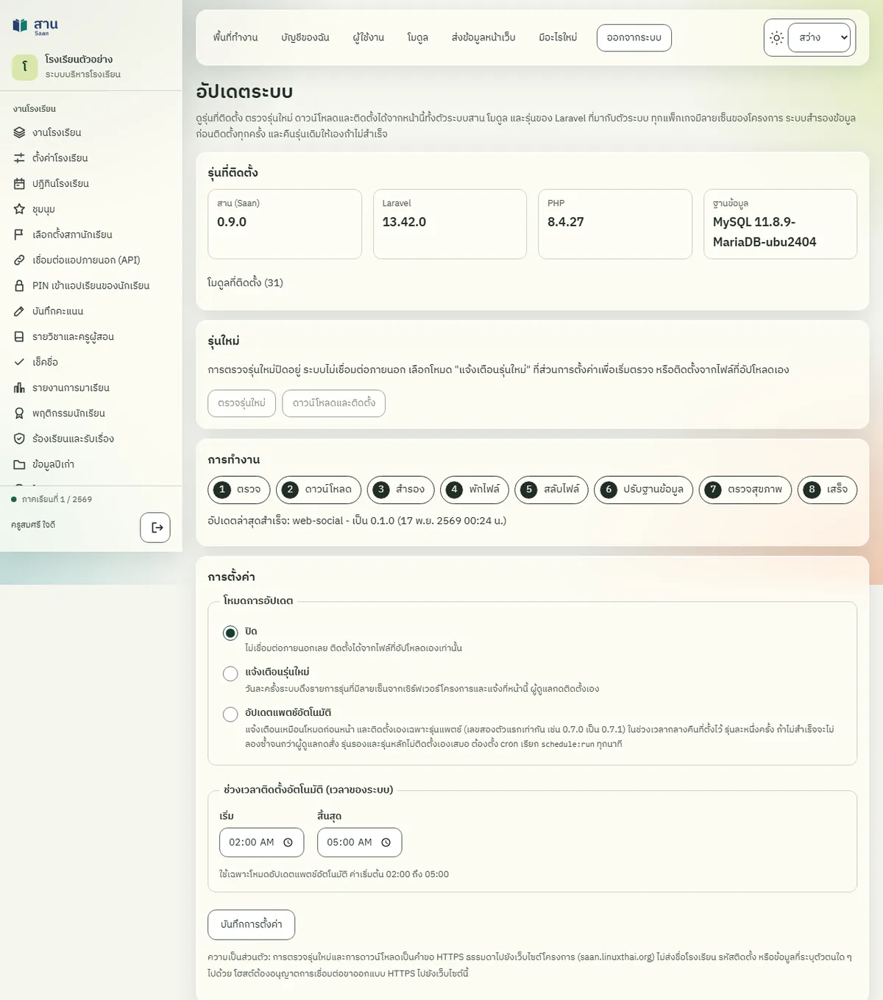

### 11.2 อัปเดต image (Debian, PHP, Apache และแพ็กเกจสานใน image)

ทำเดือนละครั้ง หรือเมื่อโครงการประกาศรุ่นใหม่

```bash
git pull
docker compose build --pull
docker compose up -d
docker compose exec saan saan-update
```

- `build --pull` ดึง Debian และ MariaDB รุ่นล่าสุดพร้อมแพตช์ความปลอดภัย
- ข้อมูลและไฟล์ของสานอยู่ใน volume จึงไม่หายเมื่อเปลี่ยน image
- `saan-update` ติดตั้งเฉพาะแพ็กเกจใน image ที่ใหม่กว่ารุ่นที่ติดตั้งอยู่ ผ่านตัวอัปเดตของสานเอง (ตรวจลายเซ็น สำรองข้อมูล และคืนรุ่นเดิมถ้าล้มเหลว) ถ้าอัปเดตจากหลังบ้านไปแล้ว คำสั่งนี้จะแจ้งว่าไม่มีอะไรต้องติดตั้ง
- ถ้า `.env` เปลี่ยน `SAAN_VERSION` ให้ตรงกับรุ่นที่ต้องการก่อน build

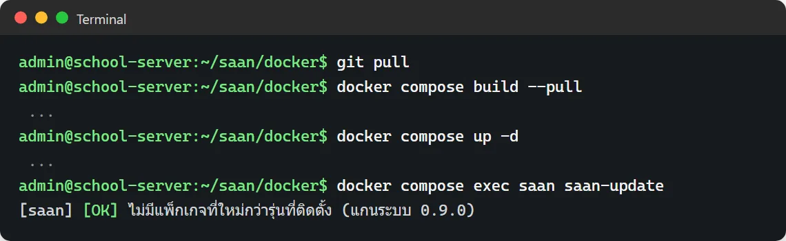

## 12. แก้ปัญหาที่พบบ่อย

| อาการ | สาเหตุและวิธีแก้ |
|---|---|
| `docker compose up` แจ้ง port is already allocated | มีโปรแกรมอื่นใช้พอร์ต 8443 หรือ 9443 อยู่ เปลี่ยน `SAAN_APP_PORT` / `SAAN_WWW_PORT` ใน `.env` ก่อนเริ่มครั้งแรก |
| แจ้ง Pool overlaps with other one on this address space | เครือข่าย 10.89.47.0/24 ซ้ำกับเครือข่ายที่มีอยู่ เปลี่ยน `SAAN_SUBNET`, `SAAN_APP_IP`, `SAAN_DB_IP` ใน `.env` ก่อนเริ่มครั้งแรก |
| เบราว์เซอร์เตือนว่าการเชื่อมต่อไม่เป็นส่วนตัว | ทำข้อ 8 ให้เครื่องนั้นเชื่อถือ CA หรือตรวจว่าพิมพ์ที่อยู่ตรงกับ `SAAN_HOSTS` |
| เครื่องอื่นในโรงเรียนเปิดไม่ได้ แต่เครื่องตัวเองเปิดได้ | Windows: ทำคำสั่ง firewall ท้ายข้อ 3.1 / Linux: ดู ufw ในข้อ 3.2 และตรวจว่า `SAAN_HOSTS` เป็น IP ของเครื่องในเครือข่าย ไม่ใช่ `localhost` |
| `saan-status` แสดง `[WARN] หน้าบ้านและระบบภายในรันด้วยผู้ใช้ระบบคนละคน` | ปกติของ container นี้ ทั้งสองฝั่งรันด้วยผู้ใช้เดียวกันเพื่อให้ตัวอัปเดตของสานอัปเดตทั้งสองฝั่งพร้อมกันได้ ส่วนเว็บไซต์โรงเรียนถูกจำกัดด้วย `open_basedir` ให้อ่านได้เฉพาะโฟลเดอร์ของตัวเอง ซึ่งเป็นทางเลือกที่ข้อความเตือนนี้ยอมรับ |
| `saan-status` แสดง `[WARN]` เรื่องเมล MFA หรือไฟล์สำรอง | เป็นงานที่ผู้ดูแลต้องตั้งต่อหลังติดตั้ง: ตั้งค่าอีเมลที่ `/cms#mail` เปิด MFA ที่หน้า "บัญชีของฉัน" และรอการสำรองอัตโนมัติครั้งแรก (หรือสั่ง `saan-backup`) |
| `saan-credentials` บอกว่ายังไม่มีไฟล์ | การติดตั้งยังไม่เสร็จ ดู `docker compose logs -f saan` |
| log ขึ้น `[ERR]` แล้ววนเริ่มใหม่ | อ่านบรรทัด `[ERR]` และไฟล์ใน `/srv/saan/logs/` (`docker compose exec saan ls /srv/saan/logs`) แก้สาเหตุแล้วรอ container เริ่มใหม่เอง |
| เว็บไซต์โรงเรียนไม่อัปเดตตามหลังบ้าน | `docker compose exec saan saan-status` ดูว่า cron ทำงาน แล้วสั่ง `saan-artisan saan:publish` ดูข้อความ |
| Windows: Docker Desktop ขึ้น WSL หรือ virtualization error | เปิด virtualization ใน BIOS แล้วสั่ง `wsl --update` ใน PowerShell แบบผู้ดูแลเครื่อง แล้ว restart |
| ต้องการเริ่มทดลองใหม่ทั้งหมด | `docker compose down -v` (ลบข้อมูลทั้งหมด) แล้ว `docker compose up -d` |

## 13. หยุดใช้และถอนออก

| ต้องการ | คำสั่ง |
|---|---|
| ปิด container แต่เก็บข้อมูลไว้ | `docker compose down` |
| ลบทุกอย่างรวมข้อมูล รหัสผ่าน และใบรับรอง | `docker compose down -v` |
| ลบ image ด้วย | `docker image rm saan:0.9.0 mariadb:11.8` |

`down -v` ลบ volume `saan_data`, `saan_db` และ `saan_secrets` ข้อมูลกู้คืนไม่ได้ สำรองและคัดลอกไฟล์สำรองออกก่อนเสมอ

## 14. ข้อมูลอ้างอิง

ข้อมูลอยู่ใน volume สามชุด

| volume | อยู่ที่ใน container | เก็บอะไร |
|---|---|---|
| `saan_data` | `/srv/saan` | `app/` ระบบภายใน `www/` เว็บไซต์ `tls/` ใบรับรอง `backups/` ไฟล์สำรอง `logs/` log ของการติดตั้งและตัวตั้งเวลา |
| `saan_db` | `/var/lib/mysql` (container db) | ฐานข้อมูลทั้งสองชุด |
| `saan_secrets` | `/srv/saan-secrets` | รหัสผ่านที่สร้างตอนติดตั้ง (สิทธิ์ 0600) |

คำสั่งช่วยใน container: `saan-status`, `saan-credentials`, `saan-artisan`, `saan-backup`, `saan-restore`, `saan-update`, `saan-tls`

ระบบภายในส่งข้อมูลไปเว็บไซต์โรงเรียนผ่าน `https://localhost:<SAAN_WWW_PORT>` ภายใน container เดียวกัน (ตั้งให้เองทุกครั้งที่เริ่ม) จึงไม่ติด firewall ของเครื่อง เช่น ufw ที่มักไม่ยอมให้ container เรียกกลับมาที่ IP ของเครื่องตัวเอง

container ฐานข้อมูลไม่เปิดพอร์ตออกนอกเครื่อง ผู้ใช้ฐานข้อมูลของแต่ละฝั่งเข้าได้เฉพาะจาก container ของสาน (ที่อยู่คงที่ `SAAN_APP_IP`) และเข้าได้เฉพาะฐานของตัวเอง เว็บไซต์โรงเรียนอ่านไฟล์นอกโฟลเดอร์ของตัวเองไม่ได้ (`open_basedir`)

## 15. เครื่องที่ใช้ทดสอบคู่มือนี้

ทดสอบกับสานรุ่น 0.9.0 วันที่ 16-17 พฤศจิกายน 2569 ด้วยคำสั่งในคู่มือนี้

| | Linux | Windows |
|---|---|---|
| เครื่อง | Ubuntu 26.04 LTS, RAM 64 GB | Windows 11 IoT Enterprise LTSC 24H2, RAM 64 GB |
| Docker | Docker Engine 29.1.3, Compose 2.40.3 | Docker Desktop (engine 29.9.3) บน WSL 3.0.5 |
| ข้อมูลตั้งต้นที่ลอง | `full` (โรงเรียนสมมติ) | `blank` |
| ติดตั้งครั้งแรก | ประมาณ 18 นาที (เครื่องมีงานอื่นรันอยู่ด้วย) | ประมาณ 5 นาที หลัง build image 104 วินาที |

ภายใน image: Debian 13.7, Apache 2.4.71, PHP 8.4.27, MariaDB 11.8.9

สิ่งที่ตรวจทั้งสองเครื่อง

- เปิดระบบภายในและเว็บไซต์ผ่าน HTTPS จากเครื่องอื่นในเครือข่าย โดยเครื่องนั้นเชื่อถือ CA ของระบบ
- รหัสผ่านไม่ปรากฏใน log ของ container และไม่อยู่ใน image
- บัญชีผู้ดูแลที่ได้รหัสผ่านจากการติดตั้งถูกพาไปหน้า "บัญชีของฉัน" ทุกหน้าและทุก API ตอบ 403 จนกว่าจะเปลี่ยนรหัสผ่าน ตั้งรหัสเดิมซ้ำไม่ได้ เปลี่ยนแล้วใช้งานได้ บัญชีทดลองไม่ถูกบังคับ
- ข้อมูลส่งไปเว็บไซต์โรงเรียนครบ (`saan:publish --verify` ตรงกันทุกตาราง)
- ผู้ใช้ฐานข้อมูลสองคนเข้าได้เฉพาะจากที่อยู่ของ container สาน
- สำรอง คัดลอกไฟล์สำรองออก แก้ข้อมูล แล้วกู้คืนด้วย `saan-restore` ได้ข้อมูลกลับมาเท่าเดิม
- `restart`, `down` แล้ว `up -d` ข้อมูลและรหัสผ่านอยู่ครบ ไม่ติดตั้งซ้ำ
- `saan-update` เมื่อไม่มีรุ่นใหม่กว่า แจ้งว่าไม่มีอะไรต้องติดตั้ง
- Windows: ย้ายเครื่องด้วยการส่งออกและนำเข้า volume (ข้อ 10.3) ระบบกลับมาด้วยข้อมูลและรหัสผ่านเดิม
- Windows: อัปเดต image ด้วย `docker compose build --pull` แล้ว `up -d` ข้อมูลเดิมอยู่ครบ
- ใบรับรองครอบทั้งชื่อเครื่องและ IP เมื่อใส่ทั้งสองอย่างใน `SAAN_HOSTS`

ยังไม่ได้ทดสอบจริงในรุ่นนี้: ติดตั้ง Docker บน Debian 13 ด้วย repository ของ Docker (ทดสอบบน Ubuntu ด้วยแพ็กเกจของ Ubuntu), การใส่ใบรับรองจริงด้วย `SAAN_TLS_CERT`, การติดตั้ง CA บน Firefox, Android และ iPhone, และ Windows 10
