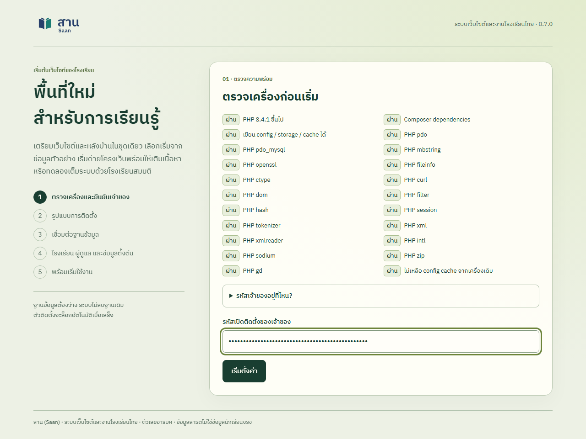
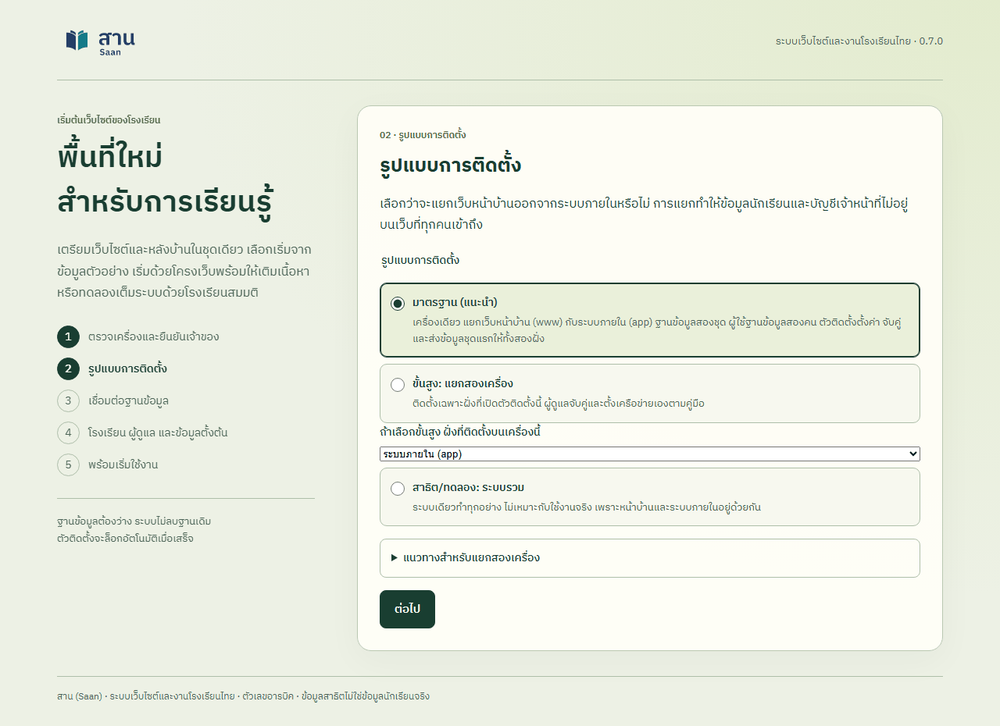
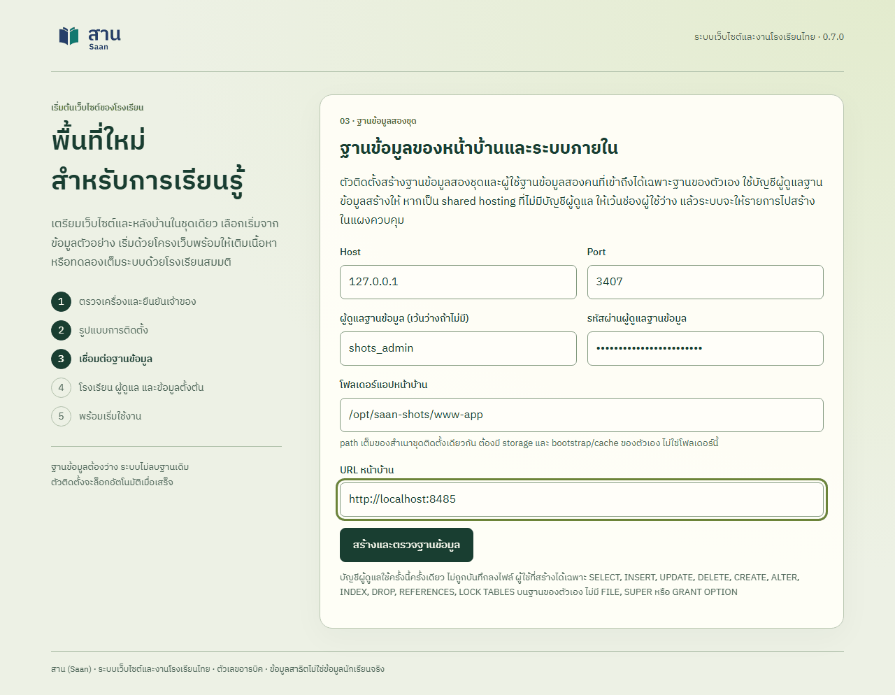
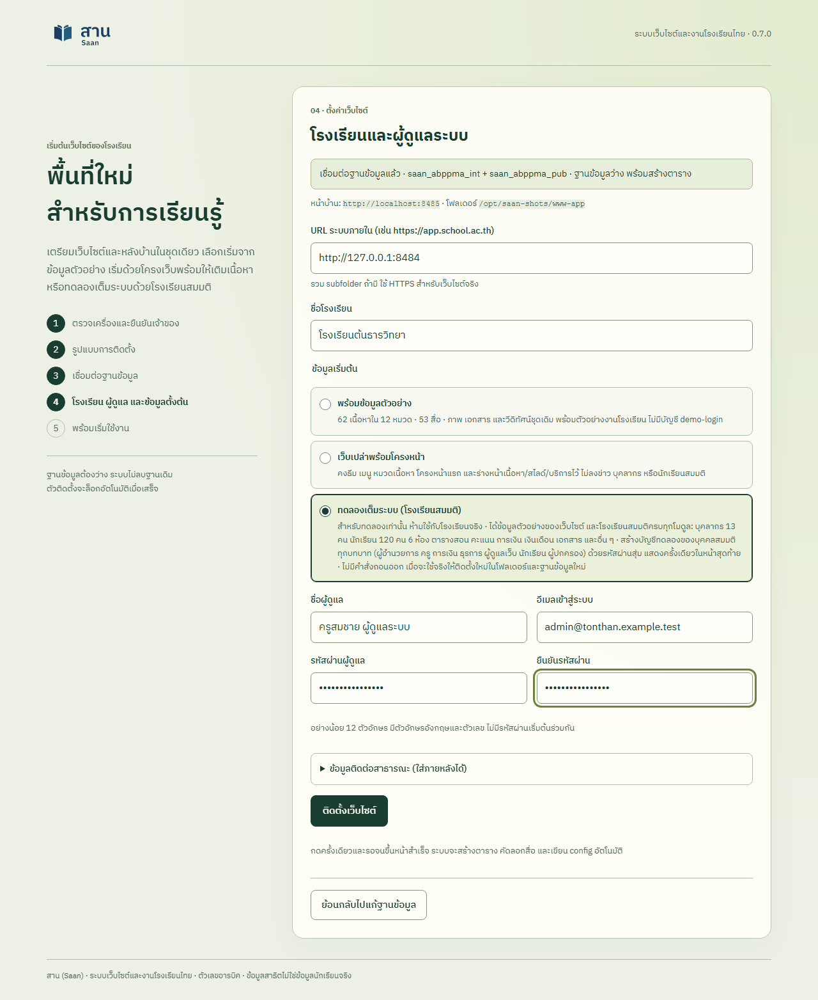
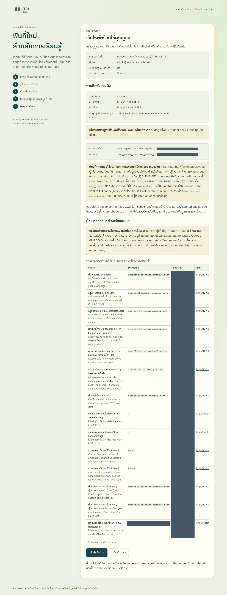
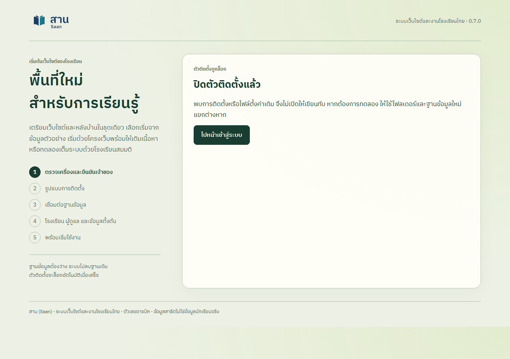
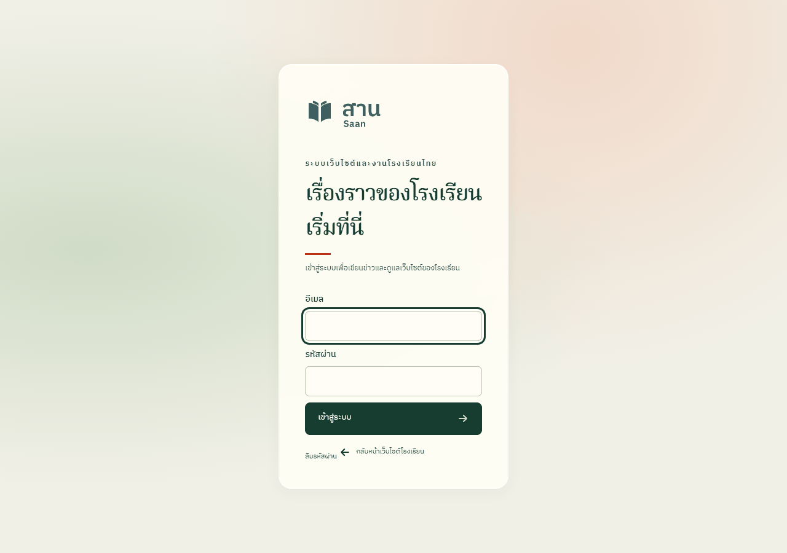

# ติดตั้งเว็บไซต์โรงเรียน เลือกข้อมูลตัวอย่าง หรือเริ่มจากโครงหน้าเปล่า

สาน (Saan) · 0.7 · คู่มือภาษาไทย · 14 พฤศจิกายน 2569

ติดตั้งผ่านเว็บ · ผู้ดูแลกำหนดเอง · cron · สำรองและกู้คืน · อัปเดต · ตรวจเมนูหลายขนาด

## สารบัญ

- [1. รุ่นนี้ทำอะไรได้ และเลือกแบบใด](#scope)
- [2. สิ่งที่ต้องเตรียม](#requirements)
- [3. เตรียมไฟล์ติดตั้ง](#files)
- [4. ตั้ง web server และ permission](#hosting)
- [5. เตรียมฐานข้อมูล](#database)
- [6. ติดตั้งผ่านเว็บทีละหน้า](#wizard)
   - [6.1 เตรียมใน DirectAdmin ก่อนเริ่ม](#da-prepare)
   - [6.3 จับคู่หน้าบ้านโดยไม่มี SSH](#pairing)
- [7. เริ่มแก้เว็บไซต์หลังติดตั้ง](#start)
   - [7.1 ตั้งค่า Gmail และ SMTP](#mail)
- [8. ตัวอย่าง config](#config)
   - [8.1 cron (งานตามเวลา)](#cron)
- [9. สำรองข้อมูล (อัตโนมัติและด้วยมือ)](#backup)
- [10. กู้คืนลงเครื่อง/ฐานใหม่](#restore)
- [11. อัปเดตระบบและโมดูล](#upgrade)
   - [11.1 บัญชี ลืมรหัสผ่าน MFA](#accounts)
   - [11.2 เปิด/ปิดโมดูล](#modules)
   - [11.3 พื้นที่ไฟล์](#quota)
- [12. ตรวจเมนูและหน้าจอหลายขนาด](#responsive)
- [13. ปัญหาที่พบบ่อย](#troubleshooting)
- [14. ชุดแจกและขอบเขตที่ตรวจแล้ว](#release)
- [15. อ้างอิงและไฟล์ config](#references)

<a id="scope"></a>

## 1. รุ่นนี้ทำอะไรได้ และเลือกแบบใด

สาน (Saan) 0.7 เป็น CMS เว็บไซต์โรงเรียนไทยบน Laravel มีหลังบ้านครบ 12 ประเภทเนื้อหา พร้อมธีม โลโก้ favicon header hero สไลด์ เมนู และคลังสื่อ ส่วนงานโรงเรียน (ทะเบียนนักเรียน เช็คชื่อ ตารางสอน การเงิน ฯลฯ) แยกเป็นโมดูล ตอนนี้มี 31 โมดูล ระดับ beta ทั้งหมด ยกเว้น operations ที่เป็น experimental ทุกโมดูลยังต้องให้โรงเรียนตรวจรับบนเครื่องทดสอบก่อนใช้กับข้อมูลจริง

|  | พร้อมข้อมูลตัวอย่าง | เว็บเปล่าพร้อมโครงเดิม |
|---|---|---|
| เผยแพร่เริ่มต้น | 62 เนื้อหา / 12 ประเภท / 53 สื่อ | ไม่มีข่าว บุคลากร หรือประกาศสมมติที่เผยแพร่ |
| หน้าแรกและธีม | ภาพ ข่าว เอกสาร วิดีโอ และสไลด์ชุด demo | ธีม เมนู หมวด hero ข้อความกลาง และพื้นที่ข่าว/ประกาศ/อัลบั้ม/กิจกรรม |
| ร่างให้แก้ต่อ | ใช้เนื้อหา demo ที่แก้ไขได้ | 11 ร่าง: 4 หน้าเนื้อหา + 3 สไลด์ + 4 ลิงก์บริการ |
| ข้อมูลครู/นักเรียน | ตัวอย่างงานเดิม: 6 ครู / 24 นักเรียนสมมติ / 3 ห้อง และตารางตัวอย่าง | ไม่มีครูหรือนักเรียนสมมติ มีภาคเรียนตั้งต้น |
| บัญชีเข้าใช้งาน | ผู้ดูแลที่สร้างเองหนึ่งบัญชี ไม่มีการคัดลอกบัญชี รหัสผ่าน session audit เก่า หรือร่างส่วนตัวจากเครื่องต้นทาง ปิด demo-login เสมอ |

แนะนำใช้โหมดเปล่าสำหรับโรงเรียนที่จะเติมข้อมูลจริงเอง และใช้โหมดตัวอย่างสำหรับทดลอง/อบรมก่อนเปิดใช้งาน เอกสาร รูปบุคลากร และกิจกรรมตัวอย่างเป็นข้อมูลสมมติทั้งหมด

> รุ่นนี้เป็น beta อย่าใส่สำเนาบัตร ทะเบียนบ้าน หนังสือเดินทาง หรือประวัติสุขภาพนักเรียนจริง จนกว่าโรงเรียนจะตรวจรับบนเครื่องทดสอบและมีนโยบายคุ้มครองข้อมูลส่วนบุคคล (PDPA) ของตนเอง โมดูลทะเบียนนักเรียน (registry) มีที่เก็บเอกสารยืนยันตัวตนแบบส่วนตัวแล้ว แต่ยังเป็น beta

**คลัง mockup ฉบับเต็ม:** ชุด upload-ready ที่รวม resources/install/library จะติดตั้งคลังภาพ บุคลากร เอกสาร PDF และชุดข้อมูลสมมติในโหมด demo เพิ่มจากสื่อ CMS 53 ไฟล์ ส่วน source จาก Git มี demo CMS เป็นหลัก และใส่ full-library bundle เพิ่มได้ก่อนติดตั้ง เมนูคลังสมมติแสดงเมื่อมีไฟล์จริง โหมดเปล่าไม่คัดลอกคลังนี้

<a id="requirements"></a>

## 2. สิ่งที่ต้องเตรียม

- **PHP 8.4.1 ขึ้นไป (8.4 หรือ 8.5)** พร้อมส่วนขยาย ctype, curl, dom, fileinfo, filter, gd, hash, intl, mbstring, openssl, pdo, pdo_mysql, session, sodium, tokenizer, xml, xmlreader และ zip (zip ใช้กับการสำรอง/กู้คืน) หน้า installer และคำสั่ง `school:doctor` ตรวจรายการเหล่านี้ให้
- **ฐานข้อมูล MariaDB 10.6 ขึ้นไป หรือ MySQL 8.0 ขึ้นไป เท่านั้น** (ไม่รองรับ SQLite และฐานข้อมูลอื่น) ต้องเป็นฐานว่าง การติดตั้งแบบมาตรฐาน (ข้อ 6) ต้องใช้ **สองฐาน** กับผู้ใช้ฐานข้อมูลสองคน (ระบบภายในหนึ่ง หน้าบ้านหนึ่ง) รุ่นที่ทดสอบจริง: MariaDB 11.8.9 / PHP 8.4.27 / Apache APM
- Composer ใช้เฉพาะเมื่อติดตั้งจาก source ZIP หรือ git; แพ็กเกจที่ลงลายเซ็น (ข้อ 3) รวม vendor แล้ว ไม่ต้องใช้ Composer, Node หรือ SSH ในการติดตั้ง
- HTTPS สำหรับเว็บไซต์จริง HTTP ยอมรับเฉพาะ localhost/127.0.0.1 สำหรับทดสอบ แบบมาตรฐานต้องมีใบรับรองสำหรับทั้งสองชื่อโดเมน
- พื้นที่ไฟล์สำหรับ source + demo ประมาณหลายร้อย MB รวม vendor และสื่อ และพื้นที่ไฟล์สำรอง (ข้อ 9: ระบบเก็บไฟล์สำรองอัตโนมัติ 7 ไฟล์ล่าสุด แต่ละไฟล์มีขนาดประมาณฐานข้อมูลบวกสื่อส่วนตัวทั้งหมด) ควรมี memory_limit 256M, post_max_size 16M, upload_max_filesize 12M, max_execution_time 120
- DocumentRoot ต้องชี้เฉพาะ public/; root แอป, .env, vendor, resources และ storage ต้องไม่เปิดจากเว็บ

> ผู้ใช้ DirectAdmin:
>
> ก่อนเปิดตัวติดตั้งให้เตรียมโดเมนสองชื่อ ฐานข้อมูล และรุ่น PHP ตามข้อ 6.1 ให้เรียบร้อย ตัวติดตั้งทำสิ่งเหล่านี้แทนคุณไม่ได้

ตัวติดตั้งจะตรวจรายการเครื่องอีกครั้ง ก่อนเขียนข้อมูล ลงบนฐานใหม่แยกจากเว็บเก่าเสมอ หากย้ายมาจาก WordPress ให้สำรองเว็บเก่าก่อน แล้วตรวจเว็บไซต์ใหม่บน staging โดยยังไม่เปลี่ยนเว็บโรงเรียนเดิม

<a id="files"></a>

## 3. เตรียมไฟล์ติดตั้ง

**วิธีที่แนะนำ: แพ็กเกจที่มีลายเซ็น** ดาวน์โหลด `saan-core-<รุ่น>.zip` จากหน้าดาวน์โหลดของโครงการ แพ็กเกจรวม vendor แล้ว จึงไม่ต้องมี Composer หรือ SSH บนโฮสต์ ภายใน zip มี `manifest.json` (รายการไฟล์ ขนาด SHA-256) `manifest.sig` (ลายเซ็น Ed25519) และโฟลเดอร์ `payload/`

1. ตรวจ SHA-256 ของ zip ให้ตรงกับหน้าดาวน์โหลด
2. แตกเฉพาะเนื้อหาใน `payload/` ไปยังโฟลเดอร์แอปนอก public_html (เช่น `/home/user/saan`)
3. ชี้ DocumentRoot หรือ symlink ของโดเมนไปที่ `saan/public`
4. เปิด `https://โดเมน/install/` แล้วทำตามข้อ 6

**โมดูล:** แพ็กเกจแกนมีเฉพาะโมดูลที่ระบบขาดไม่ได้ (web-cms เว็บไซต์โรงเรียน, operations, demo-library) ส่วนอีก 28 จาก 31 โมดูล (เช่น ITA, ข่าวจาก Facebook, ทะเบียนนักเรียน, เช็คชื่อ, การเงิน) เป็นแพ็กเกจแยก `saan-mod-<id>-<รุ่น>.zip` ติดตั้งหลังติดตั้งแกนแล้วด้วยวิธีเดียวกับการอัปเดตในข้อ 11 โมดูลที่ไม่ได้ติดตั้งจะไม่ปรากฏในเมนู

**วิธีสำหรับนักพัฒนา: source ZIP** ดาวน์โหลดซอร์สโค้ดจาก https://saan.linuxthai.org/source/ หรือจาก repository ของโครงการที่ https://github.com/ChonLaWan/saan แตกไว้นอก web root แล้วรันในโฟลเดอร์แอป ซึ่งมีโมดูลครบทุกตัว

```
composer install --no-dev --prefer-dist --no-interaction
php install.php
```

> เมื่อใช้ wizard ไม่ต้อง copy .env.example ไปเป็น .env และไม่ต้อง key:generate หรือ migrate เองก่อน
>
> wizard เขียน config และสร้าง application key ให้ หากมี .env เดิม ระบบจะปฏิเสธเพื่อป้องกันทับเว็บที่มีอยู่

โหมดตัวอย่างต้องมี resources/install/demo ครบ ระบบตรวจขนาดและ SHA-256 ก่อน import หากไม่ต้องการ demo ให้เลือกโหมดเปล่า

<a id="hosting"></a>

## 4. ตั้ง web server และ permission

ตัวอย่างนี้ติดตั้งแอปที่ /var/www/saan และเปิด https://school.example/ เปลี่ยน path และโดเมนให้ตรงเครื่องจริง

```
DocumentRoot /var/www/saan/public
# PHP website account ต้องเขียน storage/ และ bootstrap/cache/ ได้
# ระหว่าง wizard ต้องเขียนโฟลเดอร์แอปเพื่อสร้าง .env ได้ด้วย
# หลังติดตั้งแล้วลดสิทธิ์เขียน root ของแอปตาม deployment user ของเครื่อง
# .env และ backup ต้องเป็นไฟล์ private ไม่ใช่ chmod 777
```

Apache: เปิด mod_rewrite และ AllowOverride All สำหรับ public เพื่อใช้ .htaccess ส่วน nginx ต้องตั้ง try_files ไป public/index.php และส่ง PHP-FPM ที่ตรงเวอร์ชัน ตัวอย่างพร้อมแทนค่ามีใน config/examples/apache-vhost.conf และ nginx-server.conf

DirectAdmin/shared hosting: ใช้ custom document root ของโดเมนหรือ subdomain ให้ชี้ app/public หรือให้ผู้ดูแล hosting จัด symlink public_html ไป public ของแอป โดยเก็บ .env และ vendor นอก public_html อย่าเพียงอัปโหลดแอปทั้งโฟลเดอร์ลง public_html ถ้าแผงไม่ให้ปรับ document root ให้ส่งตัวอย่าง config ให้ผู้ดูแล hosting ตั้งก่อน (ชื่อเมนูและความสามารถของแผงต่างกันตามรุ่นและผู้ให้บริการ ขั้นตอนเต็มของแบบมาตรฐานอยู่ในข้อ 6.1)

APM ในเครื่องพัฒนา: สร้าง junction ใหม่จากโฟลเดอร์ย่อยของ C:\APM\www\default ไป public ของแอปที่คัดลอกสำหรับทดลอง แล้วเปิด URL โฟลเดอร์นั้น ไม่แก้ APM service หรือเว็บไซต์เดิม

ตัวอย่าง nginx ที่แจกเป็นโดเมนหลัก ส่วน subfolder บน Apache ใช้ .htaccess ที่ให้มาและใส่ APP_URL ให้รวม path จริง ไม่ใช่การ copy nginx server block ไปแทรกใน location แบบ subfolder โดยตรง

<a id="database"></a>

## 5. เตรียมฐานข้อมูล

ระบบรองรับ **MariaDB 10.6 ขึ้นไป หรือ MySQL 8.0 ขึ้นไป เท่านั้น** ไม่รองรับ SQLite

1. สร้างฐานว่าง เช่น saan เลือก utf8mb4 และ utf8mb4_unicode_ci (แผง hosting มักเติมชื่อบัญชีนำหน้า เช่น USER_saan)
2. สร้าง account ใหม่สำหรับเว็บนี้ พร้อมรหัสผ่านที่ไม่ใช้ร่วมกับเว็บอื่น
3. ให้สิทธิ์ CREATE, ALTER, INDEX, REFERENCES, SELECT, INSERT, UPDATE, DELETE เฉพาะฐานที่สร้าง ผ่านแผง hosting ตามที่ผู้ให้บริการรองรับ
4. จด host/port/ชื่อฐาน/ชื่อผู้ใช้/รหัสผ่านไว้กรอกหน้า wizard ไม่ต้อง import SQL และไม่ใช้ root

> แบบมาตรฐานต้องมีสองฐานและสองผู้ใช้
>
> (ระบบภายในและหน้าบ้านแยกกัน แต่ละผู้ใช้เข้าถึงฐานของตัวเองเท่านั้น) ตัวติดตั้งสร้างให้เองถ้ามีบัญชีผู้ดูแลฐานข้อมูล หากไม่มี (shared hosting ส่วนใหญ่) ตัวติดตั้งจะแสดงชื่อและรหัสผ่านให้ไปสร้างในแผง ดูข้อ 6.1 และ 6.2

ตรวจด้วย SHOW TABLES ได้ถ้ามี console ฐานที่มีตารางแม้เป็นของ WordPress หรือโครงการอื่นจะถูกปฏิเสธ ตัวติดตั้งไม่ DROP ตารางเดิม ไม่ migrate:fresh และไม่ใช้ DatabaseSeeder reset

<a id="wizard"></a>

## 6. ติดตั้งผ่านเว็บทีละหน้า

ตัวติดตั้ง (/install/) มี 5 ขั้น แสดงเป็นแถบด้านซ้ายของหน้าจอ: **1** ตรวจเครื่องและยืนยันเจ้าของ · **2** รูปแบบการติดตั้ง · **3** เชื่อมต่อฐานข้อมูล · **4** โรงเรียน ผู้ดูแล และข้อมูลตั้งต้น · **5** พร้อมเริ่มใช้งาน ตัวเลือกเริ่มต้นคือ **มาตรฐาน (แนะนำ)** ซึ่งแยกเว็บหน้าบ้านกับระบบภายในเป็นสองโฟลเดอร์แอป สองโดเมน และสองฐานข้อมูล ข้อมูลนักเรียนและบัญชีเจ้าหน้าที่จึงไม่อยู่บนเว็บที่ทุกคนเข้าถึง

> ภาพหน้าจอของตัวติดตั้งรุ่นก่อนถูกนำออกเพราะไม่ตรงกับขั้นตอนปัจจุบัน ข้อความในคู่มือนี้ตรงกับตัวติดตั้งรุ่นนี้

<a id="da-prepare"></a>

### 6.1 เตรียมใน DirectAdmin ก่อนเปิดตัวติดตั้ง (แบบมาตรฐาน)

ทำให้ครบก่อนเริ่มขั้นที่ 1 ชื่อเมนูในแผงต่างกันตามรุ่นและผู้ให้บริการ หากหาไม่พบให้ถามฝ่ายสนับสนุนของ hosting

1. **โดเมนสองชื่อที่ต่างโฮสต์กัน** เช่น หน้าบ้าน `www.school.ac.th` และระบบภายใน `app.school.ac.th` (โดเมนหนึ่งกับซับโดเมน หรือสองโดเมน) ตัวติดตั้งปฏิเสธถ้าสอง URL อยู่ต้นทางเดียวกัน (ชื่อโฮสต์ พอร์ต และ http/https เดียวกัน) เพราะสคริปต์ของหน้าบ้านจะอ่านระบบภายในด้วยคุกกี้ของเจ้าหน้าที่ได้ ใส่ใบรับรอง HTTPS ให้ทั้งสองชื่อ
2. **รุ่น PHP:** เลือก PHP 8.4 หรือ 8.5 ให้ทั้งสองโดเมน (ในแผงมักชื่อ Select PHP Version) แล้วเปิดส่วนขยายที่ขาดตามข้อ 2
3. **ฐานข้อมูลว่างสองฐาน กับผู้ใช้สองคน** มีสองทาง
   - ถ้า hosting ให้บัญชีผู้ดูแลฐานข้อมูลที่สร้างฐานและผู้ใช้ได้ (CREATE DATABASE, CREATE USER, GRANT) ให้ใส่ในหน้า 3 ตัวติดตั้งสร้างทั้งหมดให้พร้อมรหัสผ่านสุ่ม 32 ตัวอักษร และไม่บันทึกบัญชีผู้ดูแลนี้ลงไฟล์
   - ถ้าไม่มี (shared hosting ส่วนใหญ่) ให้เว้นช่องบัญชีผู้ดูแลว่าง ตัวติดตั้งจะแสดงรายการ ชื่อฐานสองชื่อ ชื่อผู้ใช้สองชื่อ และรหัสผ่านของแต่ละคน ให้ไปสร้างในแผง (ในแผงมักชื่อ MySQL Management) ด้วยชื่อและรหัสผ่านตามรายการ แล้วกลับมากดตรวจสอบ แผงมักเติมชื่อบัญชีนำหน้าชื่อฐานและชื่อผู้ใช้ (ชื่อผู้ใช้ยาวได้ไม่เกิน 32 ตัวอักษร) ให้แก้ชื่อในช่องของตัวติดตั้งให้ตรงกับที่แผงสร้างจริง และให้สิทธิ์แต่ละผู้ใช้กับฐานของตัวเองเท่านั้น
4. **โฟลเดอร์แอปสองโฟลเดอร์** เป็นสำเนาของแพ็กเกจรุ่นเดียวกัน (แตกเนื้อหา `payload/` สองครั้ง) ตัวอย่าง `/home/USER/domains/app.school.ac.th/saan` สำหรับระบบภายใน (โฟลเดอร์ที่เปิดตัวติดตั้ง) และ `/home/USER/domains/www.school.ac.th/saan-public` สำหรับหน้าบ้าน (path ใน File Manager ของคุณอาจต่างจากตัวอย่าง) โฟลเดอร์หน้าบ้านต้องมี vendor ครบ ไม่มีไฟล์ .env ยังไม่เคยติดตั้ง ไม่ซ้อนอยู่ในหรือคลุมโฟลเดอร์ระบบภายใน ไม่ใช้ symlink ใน storage หรือ bootstrap/cache และไฟล์ VERSION ต้องเท่ากับของระบบภายใน ตัวติดตั้งต้องเขียนโฟลเดอร์แอป storage และ bootstrap/cache ของทั้งสองฝั่งได้
5. **DocumentRoot** ของโดเมนระบบภายในต้องชี้ไปที่ `public/` ของโฟลเดอร์ระบบภายในก่อนเปิด /install/ (ตัวติดตั้งปฏิเสธถ้า DocumentRoot คือโฟลเดอร์แอปเอง) ส่วนโดเมนหน้าบ้านตั้งให้ชี้ `public/` ของโฟลเดอร์หน้าบ้านได้ก่อนหรือหลังติดตั้ง เพราะตัวติดตั้งส่งข้อมูลชุดแรกเข้าฐานหน้าบ้านโดยตรง การตั้ง DocumentRoot ใน DirectAdmin ดูข้อ 4
6. จดไว้: URL ของทั้งสองฝั่ง (HTTPS) และ path เต็มของโฟลเดอร์แอปหน้าบ้าน

<a id="wizard-steps"></a>

### 6.2 ขั้นตอนของตัวติดตั้ง

#### ขั้นที่ 1 ตรวจเครื่องและยืนยันเจ้าของ

เปิด https://app.school.ac.th/install/ ตรวจทุกข้อเป็น “ผ่าน” เปิด File Manager ของ hosting ไปที่โฟลเดอร์แอปของระบบภายใน อ่าน storage/app/private/setup/owner-token.txt แล้วกรอกรหัสเฉพาะครั้งติดตั้ง รหัสนี้อยู่นอก public ใช้ยืนยันว่าเป็นผู้ควบคุมไฟล์ของเว็บไซต์ ไม่ส่งรหัสใน URL หรือใส่ใน Git การยืนยันหมดอายุหลัง 30 นาทีและกลับมายืนยันได้จนติดตั้งสำเร็จ กรอกผิดเกินกำหนดต้องรอ 10 นาที



*ขั้นที่ 1: รายการตรวจเครื่องต้องขึ้น “ผ่าน” ทุกข้อ แล้วกรอกรหัสเจ้าของในช่องด้านล่าง (ช่องนี้แสดงเป็นจุด) ก่อนกด “เริ่มตั้งค่า” ภาพจากรูปแบบมาตรฐาน*

#### ขั้นที่ 2 รูปแบบการติดตั้ง

เลือก **มาตรฐาน (แนะนำ)** ตัวเลือกอื่น: “ขั้นสูง: แยกสองเครื่อง” (ติดตั้งทีละฝั่ง จับคู่เอง ดู docs/split-advanced.th.md และข้อ 6.3) และ “สาธิต/ทดลอง: ระบบรวม” (ระบบเดียวทำทุกอย่าง ไม่เหมาะกับใช้งานจริง)



*ขั้นที่ 2: เลือก “มาตรฐาน (แนะนำ)” แล้วกด “ต่อไป” ตัวเลือก “ขั้นสูง” และ “สาธิต/ทดลอง” อยู่ใต้ตัวเลือกนี้*

#### ขั้นที่ 3 ฐานข้อมูลสองชุด (แบบมาตรฐาน)

กรอก Host (เช่น 127.0.0.1 หรือ host ที่ hosting ให้) Port (ปกติ 3306) บัญชีและรหัสผ่านของผู้ดูแลฐานข้อมูล (เว้นว่างถ้าไม่มี) **โฟลเดอร์แอปหน้าบ้าน** (path เต็ม เช่น /home/USER/domains/www.school.ac.th/saan-public) และ **URL หน้าบ้าน** (https://www.school.ac.th) แล้วกด “สร้างและตรวจฐานข้อมูล” ระบบตรวจว่าโฟลเดอร์หน้าบ้านเป็นสำเนาเดียวกันและแยก storage ถูกต้อง จากนั้นสร้างฐานและผู้ใช้ให้ (ถ้ามีบัญชีผู้ดูแล) หรือแสดงรายการให้ไปสร้างในแผง แล้วกด “ตรวจสอบอีกครั้ง” ระบบลองเชื่อมต่อด้วยผู้ใช้แต่ละคนและต้องถูกปฏิเสธเมื่ออ่านฐานของอีกฝั่ง ผู้ใช้ต้องไม่มีสิทธิ์ระดับเซิร์ฟเวอร์หรือ GRANT OPTION จดรหัสผ่านทั้งสองชุดไว้ หน้านี้แสดงจนกว่าจะตรวจผ่าน และหน้าสุดท้ายแสดงอีกครั้งเดียว



*ขั้นที่ 3: กรอกข้อมูลเซิร์ฟเวอร์ฐานข้อมูล บัญชีผู้ดูแลฐานข้อมูล (รหัสผ่านแสดงเป็นจุด) โฟลเดอร์แอปหน้าบ้าน และ URL หน้าบ้าน แล้วกด “สร้างและตรวจฐานข้อมูล” ค่าในภาพเป็นค่าสมมติของเครื่องทดสอบ*

#### ขั้นที่ 4 โรงเรียน ผู้ดูแล และข้อมูลตั้งต้น

กรอก URL ของ**ระบบภายใน** (เช่น https://app.school.ac.th ตรวจให้ตรงกับที่เปิดจริง รวม subfolder ถ้ามี) ชื่อโรงเรียน เลือก “พร้อมข้อมูลตัวอย่าง” หรือ “เว็บเปล่าพร้อมโครงหน้า” ตั้งชื่อผู้ดูแล อีเมลเข้าสู่ระบบ และรหัสผ่านอย่างน้อย 12 ตัว มีตัวอักษรอังกฤษและตัวเลข ไม่เกิน 72 bytes ยืนยันให้ตรงกัน ข้อมูลติดต่อสาธารณะ (อีเมล โทรศัพท์ ที่อยู่) ใส่ภายหลังได้ กด “ติดตั้งเว็บไซต์” ครั้งเดียวและรอ ระบบสร้างตารางในทั้งสองฐาน ผู้ดูแล เนื้อหา สื่อ จับคู่กุญแจระหว่างสองฝั่งในเครื่องเอง ส่งข้อมูลหน้าเว็บชุดแรกไปฐานหน้าบ้าน แล้วจึงเขียนไฟล์ .env ของสองฝั่ง (สิทธิ์ 0600) และล็อกตัวติดตั้งทั้งสองฝั่ง หากขั้นใดไม่สำเร็จ ระบบลบตารางที่สร้างในรอบนั้นและไม่ล็อกอะไร เริ่มใหม่ได้



*ขั้นที่ 4: กรอก URL ระบบภายใน ชื่อโรงเรียน เลือกข้อมูลเริ่มต้น และตั้งบัญชีผู้ดูแล (รหัสผ่านแสดงเป็นจุด) ภาพนี้เลือก “ทดลองเต็มระบบ (โรงเรียนสมมติ)” ซึ่งใช้ทดลองเท่านั้น ชื่อโรงเรียนและบัญชีในภาพเป็นข้อมูลสมมติ*

#### ขั้นที่ 5 พร้อมเริ่มใช้งาน

หน้าสรุปแสดงรหัสติดตั้ง URL สองฝั่ง และผลจับคู่ ถ้าตัวติดตั้งสร้างฐานให้ จะแสดงชื่อฐาน ผู้ใช้ และรหัสผ่านฐานข้อมูล**ครั้งเดียว** ให้บันทึกทันที (รหัสอยู่ในไฟล์ .env ของแต่ละฝั่งด้วย) แล้วกด “เข้าสู่หลังบ้าน” ด้วยอีเมลและรหัสผ่านที่ตั้งเอง ไม่มีบัญชี demo ตัวติดตั้งล็อกและลบรหัสเปิดติดตั้งแล้ว กลับเข้า /install/ จะเป็นหน้าปิดตัวติดตั้ง



*ขั้นที่ 5: หน้าสรุปหลังติดตั้ง หน้าจอจริงแสดงรหัสผ่านฐานข้อมูลของสองฝั่งและรหัสผ่านบัญชีทดลองเป็นข้อความอ่านได้ **เพียงครั้งเดียว** ในภาพนี้ปิดทับค่าเหล่านั้นไว้ เมื่อติดตั้งจริงให้จดทันทีก่อนออกจากหน้านี้*



*เมื่อเปิดหน้าติดตั้งอีกครั้งหลังติดตั้งเสร็จ จะพบหน้า “ปิดตัวติดตั้งแล้ว” และไม่มีฟอร์มให้กรอก*



*หน้าเข้าสู่ระบบหลังติดตั้ง ใช้อีเมลและรหัสผ่านผู้ดูแลที่ตั้งไว้ในขั้นที่ 4*

#### สิ่งที่ต้องทำต่อหลังขั้นที่ 5 (แบบมาตรฐาน)

1. ถ้ายังไม่ได้ตั้ง ให้ตั้ง DocumentRoot ของโดเมนหน้าบ้านไปที่ `public/` ของโฟลเดอร์หน้าบ้าน
2. **ตั้ง cron สองบรรทัด** (ระบบภายในหนึ่ง หน้าบ้านหนึ่ง) ตามข้อ 8.1 ถ้าไม่ตั้ง ข้อมูลใหม่จะไม่ถูกส่งไปหน้าบ้านและงานตามเวลาทั้งหมดไม่ทำงาน
3. **แยกสิทธิ์ระบบปฏิบัติการของหน้าบ้าน** ตัวติดตั้งเขียนไฟล์ของทั้งสองฝั่งด้วยผู้ใช้ระบบคนเดียวกัน การแยกฐานข้อมูลจึงยังไม่พอ ถ้าหน้าบ้านถูกเจาะ ผู้โจมตีอาจอ่าน .env และกุญแจของระบบภายในได้ ให้แยกผู้ใช้ระบบของ PHP-FPM หน้าบ้านและตั้งสิทธิ์โฟลเดอร์ หรืออย่างน้อยตั้ง `open_basedir` ของโดเมนหน้าบ้านให้เป็น `<โฟลเดอร์หน้าบ้าน>:/tmp` (ใน DirectAdmin ตัวติดตั้งแนะนำให้ทำที่ Domain Setup แล้วเปิด PHP open_basedir ต่อโดเมน หรือใช้ Custom php-fpm pool) รายละเอียดอยู่ใน docs/split-advanced.th.md หัวข้อ 7 ทำแล้วรัน `school:doctor` ต้องไม่มี [WARN] เรื่องผู้ใช้ระบบหรือ open_basedir
4. เปิด `/admin/pairing` ในระบบภายใน ดูสถานะการเชื่อมต่อ เปิดหน้าเว็บหน้าบ้านและตรวจว่าเนื้อหาขึ้นครบ และเปิด `/cms#deployment` ตรวจรายการทั้งหมด
5. เข้าหลังบ้านและเริ่มแก้เว็บไซต์ตามข้อ 7

<a id="pairing"></a>

### 6.3 จับคู่หน้าบ้านโดยไม่มี SSH (รูปแบบขั้นสูง หรือจับคู่ใหม่)

แบบมาตรฐานจับคู่ให้อัตโนมัติ ส่วนแบบ “ขั้นสูง” (สองเครื่อง ติดตั้งทีละฝั่ง) และการจับคู่ใหม่หลังหมุนกุญแจ ต้องจับคู่เอง ถ้ามี SSH ใช้คำสั่งตาม docs/split-advanced.th.md หัวข้อ 2 (`php artisan saan:pair-token` บนหน้าบ้าน แล้ว `php artisan saan:pair https://app.school.ac.th <รหัส>` และ `php artisan saan:publish --full` บนระบบภายใน) ถ้าไม่มี SSH ใช้แบบฟอร์มบนเว็บของหน้าบ้าน:

1. ที่ File Manager ของฝั่งหน้าบ้าน สร้างไฟล์ `storage/app/private/saan-pair.token` ใส่รหัสเจ้าของเครื่องที่คุณตั้งเองบรรทัดเดียว ยาวอย่างน้อย 32 ตัวอักษร ใช้ A-Z a-z 0-9 _ - และมีตัวอักษรต่างกันอย่างน้อย 16 ตัว (รหัสที่สั้นหรือซ้ำเป็นแบบ ๆ ถูกปฏิเสธและหน้าจะตอบ 404) ไฟล์นี้อยู่นอก public
2. ในระบบภายใน เปิด `/admin/pairing` (หน้า “เชื่อมเว็บไซต์หน้าบ้าน”) ออกรหัสจับคู่ รหัสใช้ได้ 15 นาที และใช้ได้ครั้งเดียว
3. เปิด `https://www.school.ac.th/_saan/setup` กรอกรหัสเจ้าของเครื่อง (ข้อความในไฟล์ saan-pair.token) ที่อยู่ระบบภายใน (https://app.school.ac.th) และรหัสจับคู่ แล้วกด “จับคู่”
4. เมื่อสำเร็จ ไฟล์ saan-pair.token ถูกลบเอง และระบบภายในจะส่งข้อมูลหน้าเว็บชุดเต็มมาภายใน 1-2 นาที (ต้องมี cron ฝั่งระบบภายในตามข้อ 8.1) กรอกรหัสเจ้าของผิด 10 ครั้งจากเครือข่ายเดียวกันจะถูกล็อก 15 นาที (ไฟล์ยังอยู่) ถ้าไม่มีไฟล์นี้ หน้า /_saan/setup ตอบ 404 เสมอ จึงไม่เปิดช่องทางทิ้งไว้หลังติดตั้ง ถ้าไฟล์ค้างเกินหนึ่งชั่วโมง `school:doctor` จะเตือน และการจับคู่ต้องใช้ HTTPS ระบบไม่ตามการ redirect

ฟอร์ม /_saan/setup ใช้ได้เฉพาะฝั่งหน้าบ้านเท่านั้น

<a id="start"></a>

## 7. เริ่มแก้เว็บไซต์หลังติดตั้ง

1. เข้า /cms#branding เปลี่ยนโลโก้ ชื่อ คำขวัญ ภาพแยกสว่าง/มืด/มือถือ ขนาด สี และ alt
2. เข้า /cms#header ปรับ utility bar, เมนู, CTA, สี ขนาด ความกว้าง และ sticky; จัดรายการเมนูใน /cms#menus
3. เข้า /cms#hero-design ปรับ hero รวม และเข้า /cms#slides แก้แต่ละสไลด์ รูป จุดโฟกัสมือถือ ข้อความ ปุ่ม และการเล่น
4. เข้า /cms#identity ปรับ favicon และค่าโหมดสี; เข้าเมนูข้อมูลโรงเรียนใส่ที่อยู่ โทรศัพท์ อีเมล และ SEO จริง
5. ทดลองข่าวหนึ่งรายการเป็น draft ก่อน ดู preview แล้วเผยแพร่ ตรวจหน้ารวมและหน้าอ่านทั้งมือถือ/คอมพิวเตอร์
6. ถ้าเลือกเว็บเปล่า ร่างหน้า/สไลด์/บริการยังไม่เผยแพร่ จึงไม่ทำให้ผู้ชมเห็นข้อความที่ยังไม่พร้อม เลือกภาพและกรอกเนื้อหาแล้วจึงเผยแพร่
7. ถ้าเลือก demo ให้นำประกาศ/บุคลากร/ข้อมูลสมมติที่ไม่ต้องการออก และใส่ข้อมูลที่โรงเรียนตรวจแล้ว อย่าเปิดรับสมัคร/เสนอราคาตามประกาศอ้างอิง

การเก็บร่างและเผยแพร่ logo/header/hero ทำเฉพาะส่วน ไม่เผยแพร่ร่างเฉลิมฉลองหรือหมวดอื่นที่ยังไม่พร้อม หากเกิด version conflict ให้โหลดค่าล่าสุดและทบทวนก่อนส่งใหม่ ไม่ฝืนทับงานของผู้ดูแลอีกคน

<a id="mail"></a>

## 7.1 ตั้งค่า Gmail และ SMTP

เข้าหลังบ้านด้วยผู้ดูแล เลือก “ตั้งค่าการส่งอีเมล” หรือ /cms#mail มีตัวเลือกค่าจากเซิร์ฟเวอร์ ปิดการส่ง Gmail และ SMTP ทั่วไป กล่องจำลองในเครื่องจะแสดงเฉพาะการติดตั้ง local เท่านั้น

### Gmail / Google Workspace

1. เจ้าของบัญชีเข้า [ความปลอดภัย Google](https://myaccount.google.com/security) แล้วเปิดการยืนยัน 2 ขั้นตอน
2. เข้า [App Passwords](https://myaccount.google.com/apppasswords) ตั้งชื่อสำหรับเว็บไซต์ แล้วสร้างรหัสของแอป
3. เลือก Gmail ใน CMS กรอกอีเมลบัญชี Google และ App Password 16 ตัว ช่องว่างที่ Google แสดงแบ่งกลุ่มไม่เป็นส่วนของรหัส ห้ามใช้รหัสบัญชี Google ปกติ
4. ระบบกำหนด smtp.gmail.com และอีเมลผู้ส่งให้ตรงบัญชี ใช้ STARTTLS port 587 หรือ SSL/TLS port 465 แล้วบันทึก
5. กรอกอีเมลผู้รับทดสอบ ส่งหนึ่งครั้ง และตรวจ Inbox/Spam ของผู้รับ ข้อความ “SMTP ยอมรับ” ยืนยันเฉพาะการรับส่งจาก SMTP ไม่ยืนยันว่าเข้ากล่องหลัก

ถ้าไม่พบเมนู App Password ให้ผู้ดูแล Google Workspace ตรวจนโยบายบัญชี รูปแบบ 2-Step Verification และ Advanced Protection ตาม [คู่มือ Google](https://support.google.com/accounts/answer/185833?hl=th) เมื่อเปลี่ยนรหัสผ่าน Google ต้องตรวจและอาจสร้าง App Password ใหม่

### SMTP ของ hosting

กรอก host, port, TLS, username/password ตามผู้ให้บริการ ตั้งอีเมลผู้ส่ง ชื่อผู้ส่ง และ Reply-To ถ้าต้องการ ระบบบังคับ TLS และตรวจ certificate สำหรับ SMTP ภายนอก ไม่ปิดการตรวจ certificate เพื่อแก้ปัญหาส่งไม่ผ่าน หาก hosting บล็อก port ให้ติดต่อผู้ดูแล hosting

### การเก็บรหัสและการสำรอง

ข้อมูล SMTP เก็บเข้ารหัสด้วย APP_KEY ไม่แสดงรหัสเดิมในฟอร์มหรือ API เว้นว่างเพื่อเก็บรหัสเดิม เลือกลบรหัสเพื่อเอาออก หากเปลี่ยน host หรือบัญชีต้องใส่รหัสใหม่ เก็บ APP_KEY คู่กับ backup ในที่ส่วนตัว ผู้ดูแลอีเมลเท่านั้นที่มีสิทธิ์เข้าเมนูนี้

ตัวเลือก “ค่าจากเซิร์ฟเวอร์” ใช้ MAIL_* ตาม .env; ค่าเริ่มต้นชุดติดตั้งใหม่เป็น log ยังไม่ส่งออกจริง อ่านค่าตัวอย่างใน config/examples/mail.env.example โดยไม่ commit รหัสจริง

<a id="config"></a>

## 8. ตัวอย่าง config และงานตามเวลา

wizard เขียน .env ด้วยค่า production: APP_DEBUG=false, SCHOOL_DEMO=false, SESSION_ENCRYPT=true, cookie HttpOnly/SameSite และ Secure สำหรับ HTTPS พร้อม application key เฉพาะเว็บ ค่า config ตัวอย่างเป็น placeholder ไม่มีรหัสผ่านใช้ร่วมกัน

```
APP_ENV=production
APP_DEBUG=false
APP_URL=https://school.example
DB_CONNECTION=mysql
DB_HOST=127.0.0.1
DB_DATABASE=saan
DB_USERNAME=saan
DB_PASSWORD="REPLACE_PRIVATELY"
SESSION_ENCRYPT=true
SESSION_SECURE_COOKIE=true
SCHOOL_DEMO=false
SCHOOL_LOCAL_ONLY=false
```

เขตเวลากำหนดตายตัวเป็น Asia/Bangkok ใน config/app.php ไม่มีตัวแปร APP_TIMEZONE ใน .env ที่เปลี่ยนค่านี้ได้ (school:doctor เตือนถ้าไฟล์นั้นถูกแก้เป็นอย่างอื่น) ตัวแปรเสริมที่ใช้บ่อย (โควตาไฟล์ โมดูล การสำรองอัตโนมัติ รหัส hash) มีคำอธิบายหนึ่งบรรทัดในไฟล์ .env.example เมื่อแก้ .env ด้วยตัวเองให้ตรวจการ quote สตริงและรัน config:clear ก่อนสร้าง cache ใหม่ สำหรับ subfolder ให้ SESSION_PATH รวม path เช่น /school และให้ APP_URL มี /school ด้วย wizard ใส่ให้ตาม URL ที่ยืนยัน

```
php artisan optimize:clear
php artisan config:cache
php artisan view:cache
php artisan school:doctor --json
```

รอ cron ทำงาน (ข้อ 8.1) แล้วดู school:doctor อีกครั้ง ค่าที่ขึ้นเตือน HTTPS บน localhost เป็นผลของเครื่องทดสอบ ไม่ใช่สิ่งที่ควรละเลยบนเว็บไซต์จริง ค่าเมลเริ่มเป็น log เพื่อไม่ส่งข้อความโดยไม่ได้ตั้ง server ตั้งค่า SMTP ของโรงเรียนที่ /cms#mail (ข้อ 7.1) หรือ MAIL_* ใน .env ให้ถูกต้องก่อนเปิดงานส่งอีเมล เมลนี้ใช้กับลืมรหัสผ่านและลิงก์เชิญผู้ใช้ (ข้อ 11.1)

<a id="cron"></a>

### 8.1 cron (งานตามเวลา): ต้องตั้งเสมอ

cron เรียกตัวตั้งเวลาของระบบ (`schedule:run`) ทุกนาที ตัวตั้งเวลานี้ไม่ได้มีหน้าที่แค่เผยแพร่ข่าวตามเวลา แต่ขับงานต่อไปนี้ทั้งหมด (ตรวจจาก routes/console.php):

- เผยแพร่เนื้อหาตามเวลา (`cms:publish-due`) และสัญญาณ “cron ทำงาน” ที่หน้าตรวจความพร้อมอ่าน (ทุกนาที)
- ส่งข้อมูลจากระบบภายในไปหน้าบ้าน (`saan:publish`) และดึงข้อความ/แบบฟอร์มที่ผู้เข้าชมส่งมาที่หน้าบ้านกลับเข้าระบบภายใน (`saan:inbox-pull`) ทุกนาที ถ้า cron หยุด หน้าบ้านจะไม่ได้ข่าวใหม่ และฟอร์มจากหน้าบ้านจะค้าง
- ฝั่งหน้าบ้าน: ลบซองข้อความที่ไม่มีใครดึงเกิน 7 วัน ส่งยอดดาวน์โหลดและยอดอ่านข่าวกลับ และปิดบังชื่อเต็มในประกาศรายชื่อเมื่อถึงเวลาหมดอายุ (แม้ระบบภายในจะปิดอยู่)
- ลบหรือปิดบังข้อมูลตามกำหนดเก็บของโมดูลที่ติดตั้ง (เช่น ชื่อเต็มของประกาศรายชื่อที่หมดอายุ บันทึกคำขอ API รูปแจ้งซ่อม สลิปการเงินและเงินเดือน ไฟล์บุคลากรเกินกำหนด) และเก็บกวาดตัวนับยอดอ่านข่าวเก่า
- สำรองข้อมูลอัตโนมัติรายวัน (ข้อ 9)
- ตรวจรุ่นใหม่วันละครั้ง (เฉพาะเมื่อผู้ดูแลเปิดที่ /admin/updates) และปิดงานอัปเดตที่ค้างให้เองภายในหนึ่งนาที (`saan:update --recover --auto` ข้อ 11)

**บรรทัดเดียวต่อหนึ่งโฟลเดอร์แอป** รูปแบบสำหรับ DirectAdmin (แก้ USER, DOMAIN และ path ของ PHP ให้ตรงกับของคุณ):

```
* * * * * /usr/local/php84/bin/php /home/USER/domains/DOMAIN/saan/artisan schedule:run >/dev/null 2>&1
```

> ติดตั้งแบบมาตรฐานต้องมีสองบรรทัด
>
> หนึ่งบรรทัดต่อโฟลเดอร์ระบบภายใน และอีกหนึ่งบรรทัดต่อโฟลเดอร์หน้าบ้าน (path ของ artisan ต่างกัน) ถ้าตั้งเพียงฝั่งเดียวอีกฝั่งหนึ่งจะไม่ทำงานตามเวลา ไม่ต้องรัน queue worker เพราะ QUEUE_CONNECTION=sync (ตัวติดตั้งเขียนค่านี้ให้ และระบบไม่มีงานคิวที่ต้องมี worker)

```
* * * * * /usr/local/php84/bin/php /home/USER/domains/app.school.ac.th/saan/artisan schedule:run >/dev/null 2>&1
* * * * * /usr/local/php84/bin/php /home/USER/domains/www.school.ac.th/saan-public/artisan schedule:run >/dev/null 2>&1
```

**วิธีตั้งใน DirectAdmin:** เข้าบัญชีผู้ใช้ เมนูที่ชื่อ Cron Jobs (มักอยู่ใต้ Advanced Features ชื่อเมนูอาจต่างตามรุ่นและธีม) เพิ่มรายการใหม่ ช่องเวลา (นาที ชั่วโมง วัน เดือน วันในสัปดาห์) ใส่ `*` ทุกช่อง ช่องคำสั่งใส่ส่วนหลังดาวห้าตัว (`/usr/local/php84/bin/php .../artisan schedule:run >/dev/null 2>&1`)

**หา path ของ PHP ที่ถูกต้อง** (path ในตัวอย่างเป็นเพียงรูปแบบที่พบบ่อยบน DirectAdmin ไม่ใช่ค่าที่แน่นอนทุกโฮสต์):

1. ดูรุ่น PHP ที่เลือกให้โดเมนในแผง (Select PHP Version) ต้องเป็น 8.4 หรือ 8.5 แล้วถามฝ่ายสนับสนุนของ hosting ว่า path ของ PHP CLI รุ่นนั้นคืออะไร บน DirectAdmin มักเป็น `/usr/local/php84/bin/php` (8.4) หรือ `/usr/local/php85/bin/php` (8.5)
2. ตรวจเอง: สร้าง cron ชั่วคราวหนึ่งรายการ (ทุกนาที) ใส่คำสั่ง `/usr/local/php84/bin/php -v > /home/USER/php-check.txt 2>&1` รอหนึ่งถึงสองนาที เปิดไฟล์ php-check.txt ใน File Manager ต้องเห็น PHP 8.4.x (cli) จากนั้นลบ cron ชั่วคราวและไฟล์นั้นทิ้ง ถ้าไม่พบไฟล์หรือไฟล์ว่าง path ไม่ถูกต้อง
3. ห้ามใช้คำว่า `php` เฉยๆ โดยไม่ตรวจ เพราะ PHP เริ่มต้นของบัญชีอาจเป็นรุ่นเก่ากว่า 8.4.1 ซึ่ง artisan ของระบบนี้จะไม่ทำงาน
4. path ของโฟลเดอร์แอป (`/home/USER/domains/DOMAIN/saan` ในตัวอย่าง) ให้ใช้ path จริงที่ File Manager แสดงสำหรับโฟลเดอร์ที่มีไฟล์ `artisan`

**ตรวจว่า cron ทำงาน:** รอสองนาทีแล้วเปิด /cms#deployment รายการ “cron (schedule:run) ทำงาน” ต้องเป็น “ผ่าน” (หรือรัน `php artisan school:doctor` ถ้ามี SSH) ถ้าสัญญาณเงียบเกิน 10 นาที ผู้ดูแลจะเห็นแถบเตือนสีส้มที่ด้านบนของหน้า /cms และ /work ที่เชื่อมไปหน้าตรวจความพร้อมนี้ ถ้าต้องการเก็บบันทึก ให้เปลี่ยน `>/dev/null 2>&1` เป็น `>> /home/USER/saan-cron.log 2>&1` (ไฟล์จะโตขึ้นเรื่อยๆ) ตัวอย่างเพิ่มเติมอยู่ใน config/examples/cron.txt

<a id="backup"></a>

## 9. สำรองข้อมูลและเก็บอย่างปลอดภัย

### สำรองอัตโนมัติ (ระบบภายในและระบบรวม)

เมื่อมี cron (ข้อ 8.1) ระบบสำรองข้อมูลให้เองทุกวัน เวลา 02:30 เป็นไฟล์ ZIP รูปแบบเดียวกับคำสั่ง `school:archive` (ฐานข้อมูลทุกตาราง สื่อและเอกสารส่วนตัว .env กับ application key และกุญแจของระบบ) แล้วเก็บเฉพาะ 7 ไฟล์ล่าสุด ไฟล์เก่ากว่านั้นถูกลบ

- **ที่เก็บไฟล์:** `storage/app/private/backups/auto-ปีเดือนวัน.zip` (เช่น auto-20261113.zip) ในโฟลเดอร์แอปของระบบภายใน เปิดดูและดาวน์โหลดได้ผ่าน File Manager ไฟล์ `pre-update-*.zip` ในโฟลเดอร์เดียวกันเป็นของตัวอัปเดต ระบบสำรองอัตโนมัติไม่แตะต้อง
- **ตั้งค่าใน .env:** `SAAN_BACKUP_DAILY_AT=02:30` (รูปแบบ ชั่วโมง:นาที ตามเวลาเซิร์ฟเวอร์ เว้นว่างเพื่อปิด) และ `SAAN_BACKUP_KEEP=7` (จำนวนไฟล์ที่เก็บ อย่างน้อย 1) แก้แล้วรัน `php artisan optimize:clear` หรือแจ้งผู้ดูแล hosting หากไม่มี SSH ให้ลบไฟล์ `bootstrap/cache/config.php` (ถ้ามี)
- **พื้นที่ดิสก์:** แต่ละไฟล์มีขนาดประมาณฐานข้อมูลบวกสื่อส่วนตัวทั้งหมด เก็บ 7 ไฟล์จึงใช้พื้นที่ราว 7 เท่า ถ้าโรงเรียนมีสื่อมาก ให้ลด SAAN_BACKUP_KEEP หรือปิดการสำรองอัตโนมัติ ระบบข้ามรอบนั้นเมื่อพื้นที่ว่างน้อยกว่า 1.5 เท่าของไฟล์ล่าสุด และบันทึกใน storage/logs
- **ตรวจสถานะ:** หน้า /cms#deployment รายการ “ไฟล์สำรองล่าสุด” เตือนเมื่อไม่มีไฟล์ หรือไฟล์ล่าสุดเก่ากว่า 3 วัน

> ต้องดาวน์โหลดไฟล์สำรองออกจากเซิร์ฟเวอร์เป็นประจำ
>
> (File Manager เลือกไฟล์ แล้วดาวน์โหลดไปเก็บเครื่องอื่นหรือที่เก็บข้อมูลของโรงเรียน เช่นสัปดาห์ละครั้ง) ไฟล์สำรองที่อยู่บนเซิร์ฟเวอร์เดียวกันจะหายไปพร้อมกันเมื่อดิสก์เสีย บัญชี hosting ถูกลบ หรือเว็บถูกเจาะ ส่วนแบบมาตรฐานสำรองเฉพาะฝั่งระบบภายใน เพราะข้อมูลหน้าบ้านสร้างคืนได้จากระบบภายในด้วย
>
> saan:publish --full

### สำรองด้วยมือ (บรรทัดคำสั่ง)

คำสั่ง archive เป็น CLI ไม่มีหน้า upload backup ผ่านเว็บ รองรับ MySQL/MariaDB เก็บ schema/ทุกตาราง/private media/.env/application key และ installed marker ใน ZIP ต้องมี PHP Zip extension โฟลเดอร์ปลายทางต้องมีอยู่ เขียนได้ และอยู่นอก public ห้ามส่ง ZIP นี้ขึ้น Git เพราะมีข้อมูลและ key จริง

```
php artisan down
php artisan school:archive backup /private/backups/school-20261113.zip
php artisan up
```

ระบุโฟลเดอร์แทนชื่อไฟล์ก็ได้ ระบบตั้งชื่อ `saan-<รหัสติดตั้ง>-<edition>-<เวลา UTC>.zip` ให้ เก็บ SHA-256 จากผลคำสั่งและคัดลอกไปพื้นที่ backup อีกชุดด้วยสิทธิ์ส่วนตัว คำสั่งไม่เขียนทับชื่อ ZIP ที่มีอยู่ จะสร้างไฟล์ชั่วคราว ตรวจ bytes ก่อนเปลี่ยนเป็นชื่อสำเร็จ ใช้ consistent DB snapshot และตรวจ hash สื่ออีกครั้ง หากมีผู้เปลี่ยนไฟล์ระหว่าง backup จะไม่ประกาศว่าสำเร็จ จึงแนะนำ maintenance ชั่วคราวสำหรับชุดเต็มที่ทำด้วยมือ

ZIP นี้ไม่ได้เข้ารหัสด้วยรหัสผ่านในตัว ต้องเก็บใน encrypted storage หรือระบบ backup ที่ควบคุมสิทธิ์เอง อย่าเก็บใน public_html, URL download หรือส่งเป็น issue attachment อายุเก็บและการลบสำรองควรกำหนดตามนโยบายโรงเรียน

<a id="restore"></a>

## 10. กู้คืนลงเครื่อง/ฐานใหม่

> การกู้คืนทำผ่านหน้าเว็บไม่ได้ ต้องใช้บรรทัดคำสั่ง
>
> (SSH หรือให้ฝ่ายสนับสนุนของ hosting รันคำสั่งให้) ไฟล์สำรองที่ดาวน์โหลดเก็บไว้จึงต้องมาคู่กับคนที่รันคำสั่งนี้ได้ ถ้า hosting ไม่ให้ SSH ให้ตกลงกับผู้ให้บริการไว้ล่วงหน้า (การตั้ง cron ชั่วคราวให้รันคำสั่งเดียวนี้อาจเป็นทางออก แต่ยังไม่ได้ทดสอบกับ hosting จริง)

1. เตรียมไฟล์แอปรุ่นเดียวกับ backup
2. สร้างฐานใหม่ว่างกับผู้ใช้ใหม่ กำหนด .env เป้าหมายที่มี DB credentials/APP_URL ของเครื่องกู้คืน
3. คัดลอก ZIP ที่เชื่อถือได้ไว้นอก public และตรวจ SHA-256 (ไฟล์ auto-*.zip ที่ดาวน์โหลดมาเก็บไว้ ใช้ได้เหมือนไฟล์ที่ทำด้วยมือ)
4. รันคำสั่งด้านล่างในโฟลเดอร์แอป

```
php artisan school:archive restore /private/backups/school-20261105.zip --yes-empty-database
php artisan optimize:clear
php artisan school:doctor --json
```

ระบบตรวจก่อนแตะฐานข้อมูล: พื้นที่ว่าง สิทธิ์เขียน checksum ทุกตาราง/ไฟล์ และ **เลขโรงเรียน/ภาคเรียน** ของ archive ต้องตรงกับเครื่องนี้ ถ้าตั้งใจย้ายข้อมูลโรงเรียนทั้งชุด ให้เพิ่ม `--use-source-school` ระบบจะคืน APP_KEY และ SCHOOL_ID/SCHOOL_TERM_ID จาก archive โดยรักษา DB credentials, APP_URL และ cookie ของเครื่องเป้าหมาย

ไฟล์สื่อจะถูกเตรียมและตรวจก่อน commit ฐานข้อมูล ทุกขั้นบันทึกในใบรับ `storage/app/private/system/restore-receipt.json` หากกู้ค้างกลางทาง (เช่น ดิสก์เต็มหลังสร้างตาราง) ให้แก้สาเหตุแล้วรันคำสั่งเดิมเพิ่ม `--resume` กับ archive ไฟล์เดิม ระบบจะทำต่อจากจุดที่ค้าง ไม่สร้างตารางซ้ำ

```
php artisan school:archive restore /private/backups/school-20261105.zip --yes-empty-database --resume
```

> รับเฉพาะ archive ที่สร้างเองและตรวจ SHA แล้วเท่านั้น ห้ามลบตาราง production เพื่อฝืนให้ผ่าน ในการติดตั้งแบบมาตรฐานกู้คืนแยกตามฝั่ง: archive ของระบบภายในกู้ลงโฟลเดอร์ระบบภายในเท่านั้น (ไม่กู้ลงหน้าบ้าน) แล้วสั่ง
>
> php artisan saan:publish --full
>
> ให้หน้าบ้านรับข้อมูลชุดเต็ม ดู docs/split-advanced.th.md หัวข้อ 6

<a id="upgrade"></a>

## 11. อัปเดตระบบและโมดูล

แพ็กเกจอัปเดตทุกไฟล์ต้องมีลายเซ็นของโครงการ ระบบปฏิเสธแพ็กเกจที่ถูกแก้ ลายเซ็นไม่ตรง รุ่นเก่ากว่าที่ติดตั้ง หรือพยายามเขียนนอกพื้นที่ของตัวเอง (เช่น .env หรือ storage) แพ็กเกจแกนใช้ `saan-core-<รุ่น>.zip` โมดูลใช้ `saan-mod-<id>-<รุ่น>.zip` รุ่นและ SHA-256 ประกาศที่ https://saan.linuxthai.org/download/

**อัปเดตตัวเองจากหลังบ้าน (หน้า อัปเดตระบบ)** ผู้ดูแลเปิดที่ `/admin/updates` (เมนู บัญชีและระบบ > อัปเดตระบบ) หน้าเดียวแสดงรุ่นที่ติดตั้ง (สาน Laravel PHP ฐานข้อมูล และโมดูล) รุ่นใหม่ที่ประกาศ (รวมรุ่น Laravel ที่เปลี่ยน เช่น 13.42.0 เป็น 13.45.1) ขนาดไฟล์ ขั้นตอนที่กำลังทำ ประวัติ และไฟล์สำรอง กด "ตรวจรุ่นใหม่" แล้ว "ดาวน์โหลดและติดตั้ง" กรอกรหัสผ่านครั้งเดียว ระบบดาวน์โหลดทีละแพ็กเกจ (ทำต่อได้ถ้าขาดกลางทาง) ตรวจ SHA-256 ที่ฟีดลงลายเซ็นไว้และลายเซ็นของแพ็กเกจ แล้วติดตั้งตามลำดับ หยุดทันทีที่แพ็กเกจใดไม่สำเร็จและบอกว่าคืนอะไรและเหลืออะไรติดตั้งอยู่ โหมดมีสามแบบ: *ปิด* (ไม่เชื่อมต่อภายนอก) *แจ้งเตือนรุ่นใหม่* (วันละครั้ง ผู้ดูแลกดติดตั้งเอง) และ *อัปเดตแพตช์อัตโนมัติ* (ติดตั้งเองเฉพาะรุ่นแพตช์ เช่น 0.7.0 เป็น 0.7.1 ในช่วง 02:00 ถึง 05:00 ที่ปรับได้ รุ่นละหนึ่งครั้ง รุ่นรองและรุ่นหลักไม่ติดตั้งเองเสมอ ต้องมี cron `schedule:run` ข้อ 8.1) ใช้ผ่านคำสั่งได้ด้วย `php artisan saan:self-update --plan` หรือ `--install --yes` โฮสต์ต้องอนุญาตการเชื่อมต่อขาออกแบบ HTTPS ไปที่ saan.linuxthai.org ไม่ส่งชื่อโรงเรียนหรือรหัสติดตั้งไปด้วย ถ้าเชื่อมต่อไม่ได้หรือเลือกโหมดปิด ใช้การอัปโหลดไฟล์เองด้านล่างได้เหมือนเดิม

**ไม่มี SSH และอัปโหลดไฟล์เอง (ผ่านหลังบ้าน)**

1. อัปโหลด `saan-core-*.zip` หรือ `saan-mod-*.zip` ผ่าน File Manager ไปที่ `storage/app/private/updates/incoming/`
2. เข้า หลังบ้าน > อัปเดตระบบ (/admin/updates) ส่วน "ติดตั้งจากไฟล์ที่อัปโหลดเอง" ระบบแสดงรุ่นปัจจุบัน รุ่นใหม่ และผลตรวจความพร้อม
3. กรอกรหัสผ่านของผู้ดูแลแล้วกด "ติดตั้งไฟล์นี้" รอจนขึ้นบันทึกผล ระหว่างนี้เว็บไซต์ปิดชั่วคราว

**มี SSH**

```
php artisan saan:update /home/user/saan-core-0.6.1.zip --check
php artisan saan:update /home/user/saan-core-0.6.1.zip
```

ขั้นตอนที่ระบบทำให้: ตรวจลายเซ็นและ SHA-256 ทุกไฟล์ → ตรวจ PHP พื้นที่ว่าง สิทธิ์เขียน และโมดูลที่ต้องใช้ → สำรองฐานข้อมูลและไฟล์ด้วย school:archive → ปิดเว็บชั่วคราว → สำรองไฟล์เดิมที่จะถูกแทน → เขียนไฟล์ใหม่ → migrate (เพิ่มอย่างเดียว) → ล้าง cache → ตรวจสุขภาพ → เปิดเว็บ หากขั้นใดไม่สำเร็จ ระบบคืนไฟล์รุ่นเดิมและเปิดเว็บให้เอง ประวัติทุกครั้งอยู่ในหน้า อัปเดตระบบ และตาราง system_updates

**ติดตั้งแบบมาตรฐาน (สองโฟลเดอร์แอป):** ปุ่มอัปเดตในหลังบ้านของระบบภายในสั่งอัปเดตทั้งสองฝั่งให้เองผ่าน PHP CLI เมื่อโฮสต์ให้เว็บเริ่ม process ได้ ถ้าไม่ได้ ระบบจะบอกให้ใช้คำสั่งเดียวที่อัปเดตทั้งสองฝั่ง (ผ่าน SSH หรือ cron ชั่วคราว หรือให้ผู้ดูแล hosting รัน)

```
php artisan saan:update --both /home/user/saan-core-0.6.1.zip
```

ระบบอัปเดตระบบภายในก่อนแล้วจึงหน้าบ้าน (path ของหน้าบ้านอ่านจาก storage/installed.json) และคืนทั้งสองฝั่งถ้าฝั่งใดล้ม ใส่ `--php=/path/ของ/php` ได้ถ้าต้องระบุ PHP สำหรับหน้าบ้านเอง

**ระหว่างอัปเดต ผู้เข้าชมเห็นอะไร:** ระบบตรวจและพักไฟล์ใหม่ขณะที่เว็บยังเปิดอยู่ แล้วจึงปิดเว็บเพื่อสลับไฟล์ ช่วงที่ปิดผู้เข้าชมเห็นหน้า “กำลังปรับปรุงระบบ” (รหัส 503) ที่โหลดใหม่เอง ข้อมูลไม่สูญหาย ในการทดสอบของโครงการช่วงนี้นานตั้งแต่ราวหนึ่งวินาทีถึงราวหนึ่งนาที ขึ้นกับจำนวนไฟล์ที่เปลี่ยน เมื่อทุกขั้นผ่านเว็บเปิดเป็นรุ่นใหม่ ถ้าไม่ผ่านระบบคืนไฟล์รุ่นเดิมและเปิดเว็บให้เอง

**ถ้าหน้า “กำลังปรับปรุงระบบ” ค้างนานผิดปกติ:** เมื่อตัวที่เริ่มอัปเดตถูกตัดกลางคัน (หมดเวลา หรือถูกปิด) cron ที่ตั้งไว้ตามข้อ 8.1 จะสั่ง `saan:update --recover --auto` ทุกนาที และปิดงานที่ค้างให้เอง ถ้าทุกขั้นผ่านแล้วเว็บเปิดเป็นรุ่นใหม่ ถ้าไม่ครบจะคืนรุ่นเดิม (จึงเป็นเหตุผลที่ cron ต้องทำงานแม้บน hosting ที่ไม่มี SSH) ถ้ามี SSH สั่งเองได้ด้วย `php artisan saan:update --recover` ใช้ได้ทั้งสองกรณีโดยไม่เสียข้อมูล

> patch (เช่น 0.6.1 → 0.6.2) แก้บั๊ก ไม่เปลี่ยนโครงฐานข้อมูลแบบลบ minor เพิ่มความสามารถและเพิ่มตาราง/คอลัมน์เท่านั้น major ต้องอ่าน CHANGELOG.md ก่อน ควรลองอัปเดตบนเครื่องทดสอบก่อนเสมอ

<a id="accounts"></a>

## 11.1 บัญชีผู้ใช้ ลืมรหัสผ่าน และยืนยันสองขั้นตอน

- **เชิญผู้ใช้:** ผู้ดูแลเพิ่มบัญชีแล้วเลือก "ส่งลิงก์ให้ผู้ใช้ตั้งรหัสผ่านเองทางอีเมล" ผู้ใช้ได้ลิงก์ใช้ได้ 72 ชั่วโมง ส่งลิงก์ใหม่ได้จากรายการผู้ใช้
- **ลืมรหัสผ่าน:** หน้าเข้าสู่ระบบมีลิงก์ "ลืมรหัสผ่าน" ระบบตอบข้อความเดียวกันเสมอเพื่อไม่บอกว่าอีเมลใดมีบัญชี ลิงก์ใช้ได้ 60 นาทีครั้งเดียว และอุปกรณ์อื่นต้องเข้าสู่ระบบใหม่
- **ยืนยันสองขั้นตอน (แนะนำสำหรับผู้ดูแล):** บัญชีของฉัน > ยืนยันสองขั้นตอน > เริ่มตั้งค่า เพิ่มคีย์ในแอป Authenticator แล้วกรอกรหัส 6 หลัก เก็บรหัสสำรอง 8 ชุดไว้ในที่ปลอดภัย (ใช้ได้รหัสละครั้ง)
- **อุปกรณ์ที่เข้าสู่ระบบ:** ดูรายการและกด "ออกจากระบบทุกอุปกรณ์อื่น" เมื่อทำโทรศัพท์หายหรือสงสัยว่ารหัสรั่ว

ทุกขั้นต้องตั้งค่าส่งอีเมลให้ทำงานก่อน (ข้อ 7.1) หากผู้ดูแลคนเดียวทำโทรศัพท์และรหัสสำรองหาย ผู้ดูแลเครื่องใช้ `php artisan school:recover-account อีเมล`

<a id="modules"></a>

## 11.2 โมดูล: เปิด ปิด และโมดูลเสริม

แต่ละส่วนของระบบเป็นโมดูลใน `modules/<id>/module.json` มีระดับความพร้อม experimental (ทดลอง), beta และ stable ตอนนี้มี 31 โมดูล ระดับ beta 30 โมดูล และ experimental 1 โมดูล (operations) ระบบใช้งานจริงปิดโมดูลทดลองเป็นค่าเริ่มต้น เพื่อไม่ให้ข้อมูลโรงเรียนเสียหาย ส่วนโมดูล beta เปิดอยู่เมื่อมีไฟล์โมดูลติดตั้งแล้ว (28 โมดูลเป็นแพ็กเกจแยกตามข้อ 3 ต้องติดตั้งเองก่อน) เปิดหรือปิดได้ที่หน้า `/admin/modules` (ผู้ดูแลเท่านั้น) หรือกำหนดใน .env

```
# เปิดโมดูลทดลองเพื่อทดสอบบนเครื่องสำรองเท่านั้น
SAAN_ENABLE_MODULES=operations
# ปิดโมดูลที่ไม่ใช้
SAAN_DISABLE_MODULES=web-social
```

แก้ .env แล้วรัน `php artisan optimize:clear` ปิดโมดูลแล้วข้อมูลยังอยู่ เปิดกลับได้ ค่าใน .env มีสิทธิ์เหนือหน้า /admin/modules เมื่อสั่งปิดโมดูล หน้านั้นแสดงสถานะทุกโมดูล ส่วนการตรวจรุ่นใหม่ (ปิดอยู่เป็นค่าเริ่มต้น) อยู่ที่หน้า /admin/updates ส่วน `school:doctor` แจ้งโมดูลที่ถูกปิดเพราะเงื่อนไขไม่ครบ

- **ITA การเปิดเผยข้อมูลสาธารณะ (web-ita):** หลังบ้าน > ITA สร้างปีงบประมาณ เลือกคัดลอกโครงจากปีก่อน (คัดลอกหัวข้อแต่ไม่คัดลอกไฟล์/ลิงก์) เพิ่มรายการพร้อมไฟล์ PDF จากคลังสื่อหรือลิงก์ https แล้วกดเผยแพร่ หน้าเว็บอยู่ที่ `/portal/ita` เพิ่มลิงก์นี้ในเมนูเว็บไซต์ได้
- **ข่าวจากเพจ Facebook (web-social):** หลังบ้าน > ข่าวจากเพจ Facebook ใส่ลิงก์เพจ แล้วเปิดบล็อกในหน้า จัดหน้าแรก ผู้ชมกดเพื่อโหลดโพสต์เอง ไม่ต้องใช้ access token

<a id="quota"></a>

## 11.3 พื้นที่ไฟล์และขนาดไฟล์

คลังสื่อมีโควตาต่อโรงเรียน ค่าเริ่มต้น 4,096 MB และไฟล์ละไม่เกิน 10 MB ปรับใน .env ให้สอดคล้องกับแพ็กเกจโฮสต์และค่า upload_max_filesize ของ PHP

```
SAAN_STORAGE_QUOTA_MB=4096   # 0 = ไม่จำกัด
SAAN_MAX_UPLOAD_MB=10
```

หน้า คลังสื่อและเอกสาร แสดงพื้นที่ที่ใช้ไป หน้าตรวจความพร้อมเตือนเมื่อใช้เกิน 90%

<a id="responsive"></a>

## 12. ตรวจเมนูและหน้าจอหลายขนาด

เมนูหน้าบ้านใช้ breakpoint 1100 CSS px: ขนาดนี้ลงมาเป็นปุ่มเปิดเมนู เหนือขึ้นไปเป็นแถบเมนูปกติ หลังบ้านใช้ drawer ที่ 1024 CSS px ปรับกฎ CSS เดิมให้ไม่เกิดเมนูแนวตั้งค้างกลาง header และปิดสถานะเดิมเมื่อข้าม breakpoint

- ทดสอบ 320, 360, 390, 480, 640, 768, 900, 1024, 1100, 1101, 1280, 1440 และ 1920 CSS px
- เปิดเมนูแล้ว Escape ปิดได้ เมื่อขยาย/ย่อข้าม breakpoint สถานะเมนูต้องกลับถูกต้อง
- เมนูที่ยาวเลื่อนในพื้นที่หน้าจอได้ ไม่ผลัก hero ลงเป็นช่องว่างใหญ่ และไม่มี horizontal page overflow
- ทดสอบ Chrome zoom 80/100/125/150% และข้อความไทยจริง รวมชื่อโรงเรียน/คำขวัญที่โรงเรียนใช้

หากเพิ่ม custom theme ให้ทดสอบกฎ responsive ของธีมด้วย อย่าเพิ่ม !important ที่เปลี่ยน display/flex-direction ของเมนูโดยไม่สอดคล้องกับ breakpoint กลาง

<a id="troubleshooting"></a>

## 13. ปัญหาที่พบบ่อย

| อาการ | ตรวจและแก้ |
|---|---|
| หน้า installer แจ้งล็อก | พบ .env หรือ installed marker จากเว็บเดิม ไม่ฝืนลบ เปิดหลังบ้านเดิมหรือใช้โฟลเดอร์/ฐานใหม่สำหรับทดลอง |
| ฐานไม่ว่าง | ตรวจว่ากรอกฐานใหม่จริง ไม่มีตาราง WordPress/โครงการอื่น ตัวติดตั้งไม่ลบทับ |
| เชื่อมฐานไม่ได้ | เช็ก host/port/prefix ชื่อฐานและ user ของ hosting; ทดสอบสิทธิ์เฉพาะฐาน ไม่ส่งรหัสผ่านใน screenshot สาธารณะ |
| สร้าง owner-token/.env ไม่ได้ | แก้ ownership/permission ของ website account ตามข้อ 4 ไม่ใช้ chmod 777 |
| 419 | session/CSRF หมดอายุ โหลดหน้า installer ใหม่และกรอก owner token อีกครั้ง |
| รูป demo ไม่ครบ | ตรวจ resources/install/demo/media และ manifest จาก package เดิม ไม่แก้ hash เพื่อข้ามไฟล์ |
| 404 ทุกหน้า | ตรวจ DocumentRoot public/, mod_rewrite/AllowOverride หรือ nginx try_files ไม่ชี้ไป root แอป |
| ติดตั้งสำเร็จแต่ login ไม่อยู่ | ตรวจ APP_URL, HTTPS, SESSION_SECURE_COOKIE และ SESSION_PATH; localhost ต้องใช้ config local ที่ wizard สร้าง ไม่คัด cookie config จากโดเมนอื่น |
| ขัดข้องระหว่างติดตั้ง | กลับหน้าเดิมด้วย owner token และฐานเป้าหมายเดิม รองรับจบขั้นตอน config หลัง receipt ของตัวเอง ต้องใช้บัญชี/รหัสผ่าน/โหมดเดิม หาก migration ค้างกลาง DDL ให้เริ่มด้วยฐานใหม่และ source แยก ไม่ reset ฐานเดิม |
| เมนูยังแสดงแบบเก่า | ตรวจ asset version/query และ reload หลัง deploy, ล้าง Laravel view/config cache ตามคำสั่ง ตรวจ breakpoint ของ custom theme และดู console errors |
| cron ไม่ทำงาน (มีแถบเตือนสีส้มบนหน้า /cms และ /work) | ตรวจ path ของ PHP (ต้อง 8.4.1 ขึ้นไป) path ของ artisan และบัญชีตามข้อ 8.1 แล้วดูรายการ “cron (schedule:run) ทำงาน” ที่ /cms#deployment หรือ school:doctor ไม่ใช้เพียงการเห็นหน้าปฏิทินเป็นหลักฐาน scheduler แบบมาตรฐานต้องมี cron ทั้งสองโฟลเดอร์ |
| หน้าบ้านไม่ได้ข่าวใหม่ หรือฟอร์มจากหน้าบ้านไม่เข้าระบบภายใน | cron ของระบบภายในหยุด หรือการจับคู่หลุด เปิด /admin/pairing ดูสถานะ ตรวจ cron ข้อ 8.1 แล้วสั่งส่งชุดเต็มด้วย `php artisan saan:publish --full` ได้ถ้ามี SSH |
| หน้า “กำลังปรับปรุงระบบ” ไม่หายหลังอัปเดต | ดูข้อ 11 รอ cron ปิดงานที่ค้าง (ภายในหนึ่งนาที) หรือสั่ง `php artisan saan:update --recover` |
| “ไฟล์สำรองล่าสุด” เตือน | ยังไม่มีไฟล์ใน storage/app/private/backups หรือเก่ากว่า 3 วัน ตรวจ cron และ SAAN_BACKUP_DAILY_AT ตามข้อ 9 หรือสำรองด้วยมือ |

<a id="release"></a>

## 14. ชุดแจกและขอบเขตที่ตรวจแล้ว

แพ็กเกจแจกไม่รวม .env, ฐานข้อมูล, ไฟล์อัปโหลด, backup, กุญแจหรือรายงานภายใน ชุด demo อยู่ resources/install/demo พร้อม manifest ดู CHANGELOG.md สำหรับรายการเปลี่ยนแปลงของแต่ละรุ่น (หรือหน้า /whats-new ในหลังบ้าน)

ตัวระบบเผยแพร่ภายใต้ AGPL-3.0-only (ไฟล์ LICENSE) ไลบรารีภายนอกและฟอนต์คงสัญญาอนุญาตของตนเอง (ฟอนต์ใช้ SIL OFL) ดู THIRD-PARTY-NOTICES.txt ภาพ demo เป็นภาพสมมติ ไม่ใช่ภาพโรงเรียนจริง

ระบบงานโรงเรียน (ตารางสอน เวร ลา เช็คชื่อ คะแนน ทะเบียน ฯลฯ) เป็นโมดูลระดับ beta (โมดูล operations เป็น experimental และปิดในระบบใช้งานจริง) ยังไม่ใช่รุ่นเสถียร ตรวจรับด้วยข้อมูลสมมติบนเครื่องทดสอบก่อนนำมาใช้งานจริง

<a id="references"></a>

## 15. อ้างอิงและไฟล์ config

- [Laravel 13 deployment](https://laravel.com/framework/docs/deployment) — server setup และ document root
- [Laravel configuration](https://laravel.com/framework/docs/configuration) — .env, configuration cache และการเก็บ secret
- [PHP PDO](https://www.php.net/manual/en/book.pdo.php) — database connection
- [PHP ZipArchive](https://www.php.net/manual/en/book.zip.php) — archive extension
- [GNU AGPL-3.0](https://www.gnu.org/licenses/agpl-3.0.html) (AGPL-3.0-only) คือสัญญาอนุญาตของสาน ดูไฟล์ LICENSE ที่แจกพร้อมโครงการ ส่วนไลบรารีภายนอกและฟอนต์คงสัญญาอนุญาตของตนเอง ดู THIRD-PARTY-NOTICES.txt
- รุ่น ซอร์สโค้ด และช่องทางแจ้งช่องโหว่: https://saan.linuxthai.org (หน้า /download/ /source/ และ /.well-known/security.txt)

ไฟล์ในโครงการ: config/examples/apache-vhost.conf, nginx-server.conf, php-production.ini, cron.txt, database.txt, mail.env.example; สรุปคำสั่งปฏิบัติการ [docs/runbook.th.md](runbook.th.md); การแยกสองเครื่องและความปลอดภัยขั้นสูง docs/split-advanced.th.md; root .env.example สำหรับการตั้ง manual/recovery เท่านั้น คู่มือส่วนใหญ่เป็นพฤติกรรมของ สาน (Saan) ที่ตรวจจากโค้ดและการติดตั้งจริง ไม่ใช่คำสั่งติดตั้ง Laravel skeleton ทั่วไป
